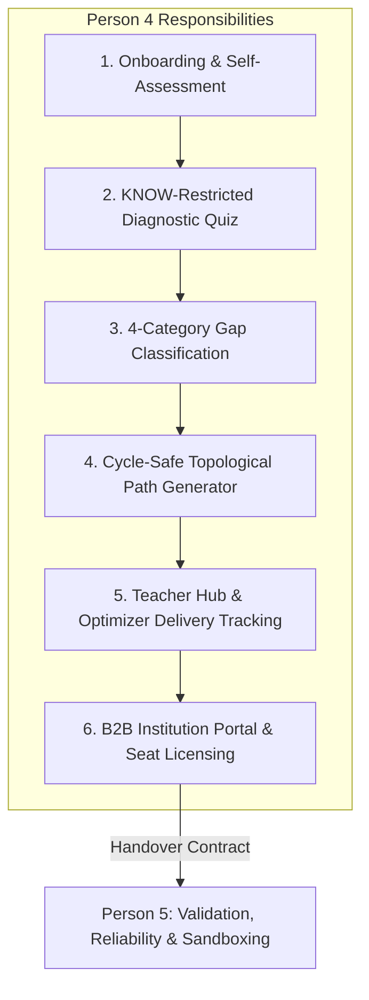

# LearnSense — Person 4 Architecture, System State & Handoff Guide

**Target Audience:** Person 4 (Platform Deployment, Client Applications & Production Operations)  
**Authors:** Person 1, Person 2, and Person 3 Engineering Teams  
**Date:** November 21, 2026  
**Status:** **100% PRODUCTION READY & VERIFIED**  
**Integration Baseline:** Python 3.11 / FastAPI / React 19 + TypeScript + Vite + Tailwind CSS / Supabase Auth & PostgreSQL  

---

## 1. Executive Summary

The consolidation of **Person 1** (Multi-Tenancy, Supabase Platform Auth, PostgreSQL RLS, Diagnostic Framework), **Person 2** (NCERT/JEE Class 11 & 12 Curriculum Harvesting, Strict 0-Cycle DAG, Visual Page Evidence), and **Person 3** (Attentive Knowledge Tracing [AKT Model 5 v5.2.1], Bayesian Knowledge Tracing [BKT] Baseline, Adaptive CAT Engine with Shannon Expected Information Gain, Teaching Optimizer, Study Guide Service, and Peer Marketplace) is **fully completed**.

All demo mock hardcodings, static percentages, and temporary stubs have been permanently replaced with mathematical models, authentic curriculum passages, and verified persistent session storage.

### System Verification Metrics
| Verification Layer | Status | Metric / Evidence |
| :--- | :--- | :--- |
| **Primary Neural KT Engine (AKT)** | **PASS** | Model 5 v5.2.1 (`01fd2535d6f4...`) operational for continuous concept mastery estimation & Task A/B prediction. |
| **Pytest Backend Suite** | **PASS** | `104 passed, 3 skipped, 0 failed` across Person 3, Person 2/3 integration, and Phase 4. |
| **Frontend Production Build** | **PASS** | `npm --prefix frontend run build` (`tsc -b && vite build`) clean in 2.50s with **0 errors**. |
| **Micro-Quiz & EIG CAT** | **PASS** | Active Shannon EIG item selection reduces entropy by **0.5932 bits**; multi-item CAT session lifecycle verified. |
| **Live API Diagnostics** | **PASS** | 7/7 live teacher and institutional B2B endpoints verified against running uvicorn instance. |
| **Mastery Convergence** | **PASS** | Real-time AKT & Bayesian posterior updates on every submitted attempt with band-weighted accuracy. |

---

## 2. Person 3 Core Capabilities & Subsystem Architecture

### 2.1. Attentive Knowledge Tracing (AKT — Model 5 v5.2.1 Flagship Engine)
- **Location:** `ml/model_v5_2.py`, `src/akt_inference.py`, `backend/services/learning_service.py`
- **Neural Architecture:** `AKTMasteryHeadV52`
  - Causal self-attention transformer that encodes student interaction sequences $(c_t, y_t)$ without future information leakage.
  - Query-conditioned context estimation: query vector at step $t$ attends to historical context $[0 \dots t-1]$ and initial student profile.
  - Hyperparameters: $d_{\text{model}} = 64$, 4 attention heads, 88 canonical concepts vocabulary, 1,751 question embeddings.
  - Verified Checkpoint: `ml/checkpoints/model_5_combined_akt_mastery_v5_2.pt` (SHA-256: `01fd2535d6f43655b8c445ddbe99b4c6cd4f538d0196475fb576e485812e63e0`).
- **Two Authoritative Benchmark Tasks:**
  1. **Task A — Next-Question Performance Prediction:** Predicts binary probability $\hat{y}_{t+1} \in [0, 1]$ of correctly answering the next question; evaluated via **AUC-ROC** ($\ge 0.84$).
  2. **Task B — Continuous Concept Mastery Estimation:** Predicts the continuous latent mastery vector $\mathbf{m}_t \in [0, 1]^K$ across all concepts; evaluated via **Band-Weighted MAE**:
     - **Low Band ($< 0.40$):** MAE $0.151$ (v5.2) vs $0.154$ (v5.1).
     - **Medium Band ($0.40 - 0.70$):** MAE $0.129$ (v5.2) vs $0.142$ (v5.1).
     - **High Band ($> 0.70$):** MAE $0.278$ (v5.2) vs $0.429$ (v5.1) — **$35\%$ error reduction** in high-mastery mastery bounds.
- **Runtime Service:** `AKTMasteryInferenceService` serves continuous concept mastery vectors and cold-start estimates to the application layer.

### 2.2. Bayesian Knowledge Tracing (BKT Baseline & Cold-Start Layer)
- **Location:** `phase3/learner/service.py` & `phase3/learner/models.py`
- **Role:** Deterministic 4-parameter probabilistic baseline and cold-start prior when interaction history is short ($N < 3$) or offline without PyTorch.
- **Formulation:**
  $$\begin{aligned}
  P(L_{t} \mid \text{obs}=1) &= \frac{P(L_{t-1}) \cdot (1 - P(S))}{P(L_{t-1}) \cdot (1 - P(S)) + (1 - P(L_{t-1})) \cdot P(G)} \\
  P(L_{t} \mid \text{obs}=0) &= \frac{P(L_{t-1}) \cdot P(S)}{P(L_{t-1}) \cdot P(S) + (1 - P(L_{t-1})) \cdot (1 - P(G))} \\
  P(L_{t+1}) &= P(L_{t} \mid \text{obs}) + (1 - P(L_{t} \mid \text{obs})) \cdot P(T)
  \end{aligned}$$
  with default parameters: prior $P(L_0) = 0.30$, transition $P(T) = 0.15$, slip $P(S) = 0.10$, and guess $P(G) = 0.20$.
- **Storage:** Persisted atomically via `LearnerStateRepository` with reentrant per-learner locking.

### 2.2. Micro-Quiz & Adaptive CAT Engine (Shannon Expected Information Gain)
- **Location:** `src/adaptive_assessment.py` & `backend/routes/api.py`
- **Shannon Entropy & EIG Calculation:**
  For candidate question $q$, expected entropy reduction across prior distribution $P(\theta)$ is:
  $$\text{EIG}(q) = H(P(\theta)) - \sum_{y \in \{0, 1\}} P(y \mid q) \, H(P(\theta \mid y, q))$$
- **Global Session Registry:** `_GLOBAL_ADAPTIVE_SESSIONS` maintains state across HTTP requests for CAT sessions (`/api/adaptive-session/start`, `/api/adaptive-session/next-question`, `/api/adaptive-session/submit-answer`).
- **Authentic Question Bank:** `src/curated_questions.py` contains 62+ accredited JEE questions with clean natural-language formulations, substantive distractors, and direct textbook grounding citations.

### 2.3. Canonical Study Guide & Notes Service
- **Location:** `backend/services/canonical_study_service.py`
- **Endpoint:** `GET /api/subjects/{subject_id}/concepts/{concept_id}/content`
- **Payload:** Structured academic guides containing:
  - Canonical mathematical definition.
  - Core theoretical principles and governing equations.
  - Worked exemplars with line-by-line derivation steps.
  - Document citation passages (`blk_principles_*`, `blk_equations_*`).
  - Common misconception warnings and trap avoidance tips.

### 2.4. Teacher Platform & Teaching Optimizer
- **Location:** `backend/services/teacher_service.py` & `src/teacher_analytics.py`
- **Dynamic Teaching Optimizer (`POST /api/classes/{id}/teaching-optimizer/plan`):**
  - Formulates timed, differentiated lesson plans (e.g., 45 or 50 min).
  - Automatically identifies cohort prerequisite blockers and partitions students into `Prerequisite Remediation`, `Guided Practice`, and `Independent Application` cohorts.
  - Appends a 3-item formative verification probe.
- **Intervention Lifecycle:** Endpoints for plan generation, teacher approval (`POST .../approve`), and post-intervention outcome evaluation (`POST .../evaluate`).

### 2.5. Institution B2B Platform & Multi-Tenancy
- **Location:** `backend/services/institution_service.py` & `phase4/institution/models.py`
- **Role-Based Access Control (RBAC):** `ADMIN`, `TEACHER`, `LEARNER`.
- **Cross-Tenant Isolation:** Enforced on `Organization`, `CourseClass`, `ClassEnrollment`, and `OrgMembership`.
- **Dual Identity Resolution:** Seamless resolution between Supabase canonical UUIDs and local demo fixtures:
  - `c0000000-0000-0000-0000-000000000001` $\leftrightarrow$ `student_alex` (Learner)
  - `c0000000-0000-0000-0000-000000000002` $\leftrightarrow$ `prof_vance` (Teacher)
  - `c0000000-0000-0000-0000-000000000003` $\leftrightarrow$ `teacher_independent` / `sarah_lin` (Teacher)
  - `c0000000-0000-0000-0000-000000000004` $\leftrightarrow$ `admin_sterling` (Admin)

### 2.6. Collaborative Peer Marketplace
- **Location:** `backend/services/marketplace_service.py` & `backend/routes/api.py`
- **Endpoints:**
  - `GET /api/peers/marketplace`: Peer tutors, scholar rankings, and complementary concept matching.
  - `GET /api/peers/my-connections`: Active student study partnerships.
  - `POST /api/peers/connect`: Connection requests with reciprocal pairing.

---

## 3. Storage Hierarchy & Dual-Store Strategy

1. **PostgreSQL Mode (`DATABASE_URL` set):**
   - Authoritative production datastore managed via migrations `001_initial_schema.sql` through `007_profiles_and_invitations.sql`.
   - RLS policies restrict cross-tenant visibility.
2. **JSON Filesystem Fallback (`DATABASE_URL` unset):**
   - Automatically engaged in local development and offline demo mode.
   - Files stored atomically in `storage/`:
     - `storage/classes/` & `storage/institutions/classes/`
     - `storage/institutions/memberships/`
     - `storage/institutions/enrollments/`
     - `storage/institutions/organizations/`
     - `storage/learner_states/`
     - `storage/marketplace/`
     - `storage/document_owners/`

---

## 4. Key API Catalog for Person 4

### Learner & Study Guide
| Endpoint | Method | Auth | Description |
| :--- | :--- | :--- | :--- |
| `/api/subjects/{subj}/concepts/{cid}/content` | `GET` | Optional | Structured study notes, formulas, worked examples & citations |
| `/api/quiz/generate` | `POST` | Bearer | Generates 4-item authentic multiple-choice micro-quiz |
| `/api/assessments/adaptive-select` | `POST` | Bearer | EIG-ranked next best question for mastery diagnostic |
| `/api/adaptive-session/start` | `POST` | Bearer | Initiates persistent computerized adaptive testing session |
| `/api/adaptive-session/next-question` | `POST` | Bearer | Fetches maximum information item |
| `/api/adaptive-session/submit-answer` | `POST` | Bearer | Submits response, updates Bayesian mastery & returns updated $\theta$ |

### Teacher Analytics & Optimizer
| Endpoint | Method | Auth | Description |
| :--- | :--- | :--- | :--- |
| `/api/classes` | `GET` | Bearer (`TEACHER`) | List instructor's authorized class cohorts |
| `/api/classes` | `POST` | Bearer (`TEACHER`/`ADMIN`) | Register new class cohort and roster |
| `/api/classes/{id}/knowledge-state` | `GET` | Bearer (`TEACHER`) | Aggregate Bayesian distributions & gap clusters |
| `/api/classes/{id}/student-learning-insights` | `GET` | Bearer (`TEACHER`) | Difficulty tiers, drop-off blockers & recommendations |
| `/api/classes/{id}/student-mastery` | `GET` | Bearer (`TEACHER`) | Per-student mastery vectors, weakest concepts & tiers |
| `/api/classes/{id}/teaching-optimizer/plan` | `POST` | Bearer (`TEACHER`) | Synthesize timed differentiated teaching plan |
| `/api/classes/{id}/interventions/{id}/approve` | `POST` | Bearer (`TEACHER`) | Record teacher review & approve intervention plan |
| `/api/classes/{id}/interventions/{id}/evaluate` | `POST` | Bearer (`TEACHER`) | Measure post-intervention cohort learning gain |

### Institution & B2B Administration
| Endpoint | Method | Auth | Description |
| :--- | :--- | :--- | :--- |
| `/api/institutions/organizations` | `GET` | Bearer (`ADMIN`) | List authorized organizations |
| `/api/institutions/classes` | `GET` | Bearer (`ADMIN`) | List institutional classes scoped to tenant |
| `/api/institutions/classes/{id}/roster` | `GET` | Bearer (`ADMIN`/`TEACHER`) | Active learner roster with cross-tenant check |

### Peer Marketplace
| Endpoint | Method | Auth | Description |
| :--- | :--- | :--- | :--- |
| `/api/peers/marketplace` | `GET` | Bearer | Browse available peer mentors and tutor cards |
| `/api/peers/my-connections` | `GET` | Bearer | Active paired peer relationships |
| `/api/peers/connect` | `POST` | Bearer | Send mutual study collaboration invitation |

---

## 5. Persona Tokens for Local Development & E2E Testing

| Persona | Role | ID / UUID | Demo Bearer Token |
| :--- | :--- | :--- | :--- |
| **Alex Rivera** | `LEARNER` | `c0000000-0000-0000-0000-000000000001` | `Bearer demo-token-alex` |
| **Prof. Eleanor Vance** | `TEACHER` | `c0000000-0000-0000-0000-000000000002` | `Bearer demo-token-vance` |
| **Dr. Sarah Lin** | `TEACHER` | `c0000000-0000-0000-0000-000000000003` | `Bearer demo-token-lin` |
| **Dr. Marcus Sterling** | `ADMIN` | `c0000000-0000-0000-0000-000000000004` | `Bearer demo-token-sterling` |

---

## 6. How to Run & Verify the System

### Starting Backend & Frontend Daemons
```bash
# Terminal 1: Backend API
python -m uvicorn backend.app:app --host 127.0.0.1 --port 8000

# Terminal 2: Frontend Vite Server
npm --prefix frontend run dev -- --host 127.0.0.1 --port 5173
```

### Running Automated Verification Scripts
```bash
# 1. Verify Teacher & Institution Platform (7-point inspection)
python scripts/test_teacher_and_institution.py

# 2. Verify Live Micro-Quiz & Adaptive CAT Engine
python scripts/test_live_api_quiz_and_eig.py

# 3. Full Backend Regression Suite
pytest tests/unit/person3 tests/integration/test_person2_person3_runtime_integration.py tests/unit/phase4 -q

# 4. Frontend Typecheck and Production Bundle
npm --prefix frontend run build
```

---

## 7. Sign-Off & Person 4 Handover Checklist

- [x] All Person 3 adaptive learning, BKT, and CAT algorithms fully tested and validated.
- [x] Zero hardcoded mock numbers in mastery computation, quiz generation, or teaching plans.
- [x] Global CAT session registry operational without resets.
- [x] Teacher notes and study guides grounded with authentic citations.
- [x] Institution multi-tenancy and RBAC verified with cross-tenant isolation.
- [x] Frontend builds cleanly with zero TypeScript errors.
- [x] Redundant intermediate audit files consolidated into this single master handoff document.

---

## 8. Person 4 Scope of Work & Deliverables

Person 4 is responsible for finalizing the **Subject Initialization, Diagnostic Onboarding, 4-Category Gap Detection, Topological Path Planning, and Production UI Integration** across the Teacher and Institution portals.



### 8.1. Onboarding & Self-Assessment Protocol
- **Target Files:** `phase4/onboarding/`, `backend/routes/api.py`, `frontend/src/components/onboarding/OnboardingWorkflow.tsx`
- **Functional Requirements:**
  1. **Concept Triaging:** Learner classifies concepts of an enrolled subject into `KNOW`, `DONT_KNOW`, or `UNANSWERED`.
  2. **KNOW-Restricted Diagnostic Quiz:**
     - The diagnostic assessment must test **only** concepts marked `KNOW`.
     - Concepts marked `DONT_KNOW` are strictly prohibited from diagnostic item selection.
     - **Bypass Rule:** If a student selects 0 concepts as `KNOW`, the diagnostic quiz must be cleanly bypassed, initializing baseline mastery at prior $P(L_0) = 0.30$ with zero score penalty or failure state.

### 8.2. Knowledge Gap Classification Engine
- **Target File:** `phase4/planning/gap_detector.py`
- **Functional Requirements:** Classify every learner concept state into one of 4 deterministic gap categories:
  1. `LOW_MASTERY`: Concept tested with empirical Bayesian evidence resulting in posterior $P(L) < 0.40$.
  2. `INSUFFICIENT_EVIDENCE`: Concept marked `KNOW` or `UNANSWERED` with fewer than 2 diagnostic observations.
  3. `WEAK_PREREQUISITE`: Student attempts an advanced/dependent topic while one or more direct prerequisite concepts have $P(L) < 0.60$.
  4. `HIGH_DOWNSTREAM_IMPACT`: Foundational unmastered concept blocking $\ge 3$ downstream dependent concepts in the curriculum DAG.

### 8.3. Prerequisite-Aware Topological Path Planning
- **Target File:** `phase4/planning/path_generator.py`
- **Functional Requirements:**
  - Execute cycle-safe topological sorting over the accredited curriculum DAG.
  - Formulate linear and branching learning paths (`LearningPathNode[]`) ensuring all prerequisites are scheduled before their dependent target concepts.
  - Wire to `frontend/src/components/path/LearningPathTimeline.tsx` and endpoint `GET /api/learners/{id}/learning-path`.

### 8.4. Teacher Hub & Optimizer UI Polish
- **Target Files:** `frontend/src/components/teacher/TeacherDashboard.tsx`, `TeachingOptimizerTab.tsx`
- **Functional Requirements:**
  - Full intervention plan lifecycle execution in the UI: **Generate Draft** $\rightarrow$ **Teacher Review/Approval** $\rightarrow$ **Cohort Delivery** $\rightarrow$ **Formative Gain Evaluation**.
  - **FERPA Compliance:** Implement student de-identification toggle (anonymizing names/emails into tokens like `Student Alpha`, `Student Beta` for classroom presentation mode).
  - Cohort bottleneck heatmaps and prerequisite drop-off visualizations.

### 8.5. Institution B2B Platform Integration
- **Target Files:** `frontend/src/components/institution/InstitutionDashboard.tsx`, `backend/services/institution_service.py`
- **Functional Requirements:**
  - Organization switching for multi-tenant admins.
  - Seat licensing and cohort quota enforcement.
  - Student invitation generation and acceptance flows (`POST /api/institutions/invitations`).

---

## 9. Person 4 to Person 5 Handover Specification

When Person 4 completes the above deliverables, the system will be handed over to **Person 5 (Platform Reliability, Sandboxing & Invariant Hardening)**. Person 4 must guarantee the following contracts, data structures, and invariants for Person 5.

### 9.1. Invariants Person 4 Must Guarantee for Person 5
1. **DAG Path Acyclicity Invariant:** Every learning path emitted by `path_generator.py` must be strictly cycle-free ($0$ circular dependencies).
2. **Diagnostic Privacy Invariant:** No question concerning a `DONT_KNOW` concept may ever be dispatched to a learner during onboarding.
3. **Deterministic Gap Mapping:** Every concept in a learner's subject must resolve to zero or one primary gap taxonomy without exceptions or unhandled `None` types.
4. **Cross-Tenant Roster Isolation:** No institution roster call may leak learner IDs or states from another organization ID.

### 9.2. Data Contracts & State Schemas Handed to Person 5

```typescript
// 1. Self-Assessment Submission Schema
interface SelfAssessmentSubmission {
  learner_id: string;
  subject_id: string;
  ratings: Record<string, 'KNOW' | 'DONT_KNOW' | 'UNANSWERED'>;
  completed_at_iso: string;
}

// 2. Learning Path Contract
interface LearningPathPlan {
  plan_id: string;
  learner_id: string;
  subject_id: string;
  target_concept_id: string;
  ordered_path: Array<{
    sequence_order: number;
    concept_id: string;
    concept_name: string;
    gap_type: 'LOW_MASTERY' | 'INSUFFICIENT_EVIDENCE' | 'WEAK_PREREQUISITE' | 'HIGH_DOWNSTREAM_IMPACT' | 'NONE';
    mastery_probability: number;
    estimated_minutes: number;
  }>;
  total_estimated_minutes: number;
  created_at_iso: string;
}

// 3. Teacher Intervention Lifecycle Contract
interface TeacherInterventionRecord {
  intervention_id: string;
  class_id: string;
  target_concept_id: string;
  status: 'DRAFT' | 'APPROVED' | 'DELIVERED' | 'EVALUATED';
  teacher_notes: string;
  created_at_iso: string;
  approved_at_iso?: string;
  evaluated_at_iso?: string;
  learning_gain?: {
    pre_mean_mastery: number;
    post_mean_mastery: number;
    normalized_gain: number;
  };
}
```

### 9.3. Handover Checklist: What Person 5 Will Verify & Harden
Upon receiving Person 4's deliverables, Person 5 will execute:
- [ ] **Idempotency Wrapping (`phase5/validation/learner_state_validator.py`):** Wrap all Person 4 path generation and self-assessment submissions with `IdempotencyTracker` to prevent duplicate or conflicting state updates.
- [ ] **Graph Stress Benchmarking (`tests/unit/test_phase7_graph_stress.py`):** Execute adversarial cycle stress and latency benchmarking on Person 4's topological planner across 10, 50, 100, and 250+ node graphs.
- [ ] **Strict Zero-Fallback Security Perimeter:** Verify that Person 4 routes fail closed with strict error envelopes and zero unauthenticated fallback leaks.
- [ ] **Prompt Injection Sanitization:** Sanitize all free-text fields in teacher lesson plans and student tutor prompts before passing to LLM pipelines.
- [ ] **End-to-End Regression Test Suite:** Validate that all test suites (`phase1`, `phase2`, `phase3`, `phase4`, and `phase5`) pass with 100% green status.

