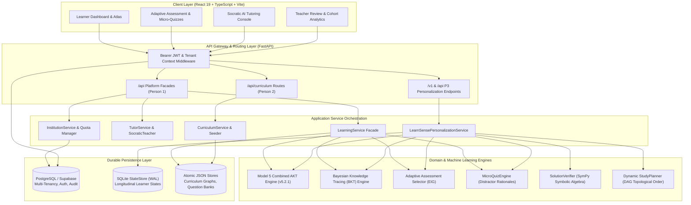
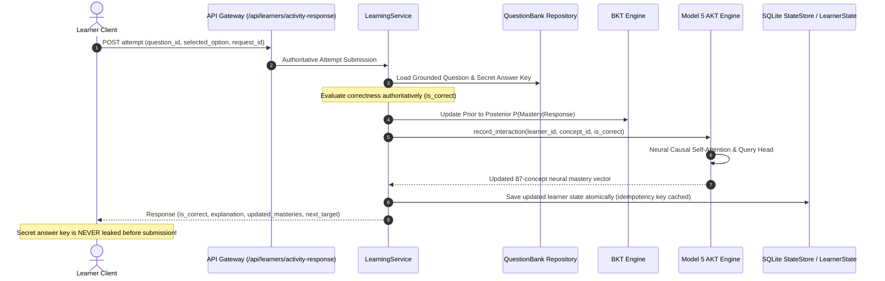

# Unified LearnSense Architecture Specification

**Document Version:** 2.0.0  
**Integration Status:** Unified Production Release (Person 1 + Person 2 + Person 3)  
**Date:** 2026-11-11  

---

## 1. System Overview & Architectural Topology

LearnSense is an enterprise-grade, pedagogically grounded adaptive learning platform designed for high-stakes STEM curricula (specifically JEE Main / Advanced and CBSE Class 11–12). The unified system synthesizes three core engineering subsystems:

1. **Person 1 — Platform, Auth & Institutional Infrastructure:** Multi-tenant PostgreSQL persistence, Supabase Bearer JWT authentication, RBAC authorization, transactional audit logging, and responsive React/Tailwind frontend.
2. **Person 2 — Canonical Curriculum, Knowledge Representation & Ingestion:** Official syllabus specification (`jee_class_11_12`, v`2026.jee.v1`), prerequisite DAG topology, NCERT layout-aware PDF/DOCX ingestion, verbatim evidence attribution, and question bank management.
3. **Person 3 — Adaptive Intelligence, Learner Modeling & AI Tutoring:** Model 5 Combined AKT neural knowledge tracing (`AKTMasteryHeadV52`), Expected Information Gain (EIG) adaptive assessment, in-topic formative micro-quizzes, multi-turn Socratic tutoring, SymPy mathematical derivation checking, and dynamic pedagogical study planning.

---

## 2. Core Subsystems & Ownership Boundaries

### 2.1 Person 1: Platform & Institutional Layer
- **Identity & Authentication:** Validates Supabase JWTs, extracts user claims (`sub`, `aud`, `org_id`, `role`), and validates tenant boundaries. Anonymous users are barred from stateful learning operations.
- **Tenant Isolation:** Enforces strict isolation across organizational workspaces (`admin_b` cannot access `admin_a` records; `learner_b` cannot access `learner_a` attempts).
- **PostgreSQL Persistence:** Models and tables for institutions, classes, enrollments, user accounts, and immutable audit trails (`audit_events`).
- **Frontend Core:** Vite-powered Single Page Application (SPA) implementing responsive dashboards, the Learning Atlas, timeline charts, and student progress bars.

### 2.2 Person 2: Curriculum & Content Grounding Layer
- **Authoritative Curriculum:** Declares and seeds `jee_class_11_12` with fingerprint `6d44446f63d5f173`. Exactly 89 concepts (87 active, 2 deprecated: `MAT_CON`, `PHY_OPT`) and 91 accepted prerequisite edges.
- **Evidence Extraction Pipeline:** Multimodal document parser converting PDF, DOCX, and PPTX textbooks into structured passages, layout tokens, and character span citations.
- **Question Bank Registry:** Grounded storage of multiple-choice and numerical questions, each bound to canonical concept IDs and verifiable source citations.
- **Curriculum Review Service:** Teacher-in-the-loop review interface for validating concept candidates, hierarchy restructuring, and prerequisite approval.

### 2.3 Person 3: Adaptive Intelligence & Personalization Layer
- **Model 5 Combined AKT Engine:** 88-concept vocabulary (index 0 reserved for causal padding), causal self-attention masking, query-conditioned concept mastery head, and sub-5ms parallel profile inference.
- **Expected Information Gain (EIG) Selector:** Optimizes item selection via Shannon entropy reduction:
  $$\text{EIG}(q) = H(Z) - \mathbb{E}_{R|q}[H(Z|R, q)]$$
- **MicroQuizEngine:** Generates formative 4-question in-topic quizzes with granular distractor rationales, instant color-coded feedback, and progressive hints.
- **Multi-Turn Socratic AI Tutoring:** 7 pedagogical modes (Explanation, Socratic Guidance, Hints, Examples, Feedback, Practice, Clarification) with verified answer-key leakage guardrails.
- **SolutionVerifier:** SymPy-powered algebraic equation equivalence and arithmetic step verification, with explicit graceful handling of unsupported diagrammatic problems.
- **Personalized StudyPlanner:** Generates DAG topologically ordered study plans respecting learner time budgets, active error streaks, and forgetting retention intervals without state mutation.

---

## 3. End-to-End Data Flows

### 3.1 Closed-Loop Attempt Ingestion & Knowledge Tracing

### 3.2 Adaptive Diagnostic Assessment (EIG)

1. **Session Start (`POST /api/initialization/diagnostic/start` or `/v1/assessments/adaptive-session/start`):**
   - Initializes learner priors from self-assessment hypotheses (or neutral default $P(L_0) = 0.5$).
   - Prerequisite gating filters candidate pool: dependent concepts are gated unless foundational prerequisites are verified or assessment objective is `diagnostic`.
2. **Item Selection (`GET .../next-question`):**
   - For each candidate question $q$, computes response probabilities $P(R=1)$ and $P(R=0)$ from current concept mastery $L$:
     $$P(R=1) = L \cdot (1 - S) + (1 - L) \cdot G$$
   - Computes posterior mastery $L_{R=1}$ and $L_{R=0}$ via Bayes' rule.
   - Calculates Expected Information Gain $\text{EIG}(q) = H(L) - \left[ P(R=1) H(L_{R=1}) + P(R=0) H(L_{R=0}) \right]$.
   - Deterministic tie-breaking selects top candidate; answer key is stripped before client projection.
3. **Session Stopping Criterion:**
   - Terminated when candidate uncertainty drops below threshold ($\sigma \le 0.20$) or question count reaches target cap (8 questions).

### 3.3 Socratic AI Tutoring with Anti-Leak Guardrails

1. **Request Intake (`POST /api/tutor/interact` or `/v1/tutoring/chat`):**
   - Receives student query, intent (`solve_with_guidance`, `hint`, `explain_concept`, `review_mistake`), target concept ID, and conversation history.
2. **Pedagogical Strategy Dispatch:**
   - Novice ($L < 0.35$): Emphasizes foundational principles and concrete intuitive analogies.
   - Developing ($0.35 \le L < 0.70$): Delivers progressive Socratic questioning, guiding without revealing the final step.
   - Mastered ($L \ge 0.70$): Explores analytical nuance, edge cases, and cross-topic transfer.
3. **Answer-Key Guardrail Sanitization:**
   - Outbound response is scanned against regex patterns (`the correct answer is [A-D]`, `answer key: ...`, `server_key`).
   - If any pattern triggers, the response is rejected or sanitized to protect assessment integrity.
   - Citations are strictly validated against verified source document pages.

### 3.4 Pedagogical Study Planning

1. **Topological Prerequisite Ordering:**
   - Traverses the 91 canonical prerequisite relationships.
   - Ensures no target concept appears in a student's plan before its unmet prerequisites are mastered.
2. **Pedagogical Priority Cascade:**
   1. Unmet Foundational Prerequisites
   2. Active Error Streaks & Misconception Traps
   3. Overdue Spaced Review (Ebbinghaus decay memory intervals)
   4. High-Uncertainty Practice
   5. New Concept Exposition & Curriculum Advancement
3. **Time-Budgeted Activity Allocation:**
   - Respects user budget (e.g. 60 min) using conservative activity estimates (15 min remediation, 10 min review, 20 min new learning).
   - Cleanly identifies complete vs. partial plans without dropping uncompleted items silently.
4. **Read-Only Invariant:**
   - Plan generation is strictly idempotent and preview-only; learner states and interaction histories are never mutated during plan inspection.

---

## 4. Persistence Division & Multi-Tenancy Architecture

| Subsystem Component | Persistence Technology | Scope & Responsibility |
|:---|:---|:---|
| **Platform Multi-Tenancy** | PostgreSQL (Supabase) | Tenant records, organization boundaries, class cohorts, teacher enrollments, and user quotas. |
| **Audit Log** | PostgreSQL (`audit_events`) | Append-only security audit log recording administrative and authentication events. |
| **Longitudinal Learner State** | SQLite (`SQLiteStateStore` with WAL) | Transactional, thread-safe longitudinal tracking of learner attempt sequences, posterior masteries, and misconception histories. |
| **Authoritative Curriculum Graph** | Filesystem (`storage/curriculum/graphs/`) | Atomic JSON representation of canonical concepts (`jee_class_11_12.json`), stable keys, aliases, and accepted edges. |
| **Authoritative Question Bank** | Filesystem (`storage/question_banks/`) | Document- and subject-scoped JSON banks holding grounded questions, answer keys, explanations, and page citations. |
| **Extracted Document Contexts** | Filesystem (`storage/learning_contexts/`) | Document-derived `LearningContext` JSON files storing extracted textbook units, sections, and source evidence chunks. |

---

## 5. Security & Academic Integrity Invariants

1. **Server-Side Authority (P0):** Client submissions provide only `question_id` and `selected_option`. The server retrieves the secret answer key and performs the authoritative comparison. No client-supplied correctness values are accepted by the production HTTP API.
2. **Answer-Key Stripping (P0):** All public endpoints projecting question items (`/api/subjects/.../question`, `/v1/assessments/.../next-question`, `/api/initialization/diagnostic/...`) strictly strip `correct_answer`, `explanation`, and `scoring_rubric` before serialization.
3. **Fail-Closed API Authentication:** In non-test environments, `LEARNSENSE_API_KEY` is mandatory. Missing or invalid keys fail closed with HTTP 401 Unauthorized / HTTP 503.
4. **Per-Learner Identity Boundaries:** When strict learner auth is active (`LEARNSENSE_ENFORCE_LEARNER_AUTH=true`), caller identity claims must match the URL path `learner_id`; unauthorized access returns HTTP 403 Forbidden.
5. **Deterministic Checkpoint Hashing:** Model 5 weights are verified on startup against `01fd2535d6f43655b8c445ddbe99b4c6cd4f538d0196475fb576e485812e63e0`. Mismatched or tampered checkpoints immediately abort inference service initialization.

