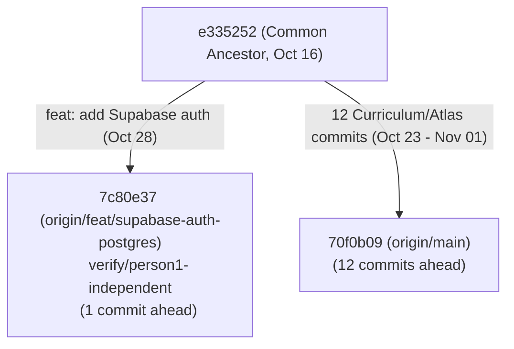

# LearnSense — Forensic Git History & Regression Audit
## Person 1 Original Branch (`feat/supabase-auth-postgres`) vs `main`

**Audit Date:** 2026-11-02  
**Auditor:** Lead Technical Auditor (Automated Forensic Verification)  
**Repository:** `https://github.com/VasaShashank/LearnSense`  
**Original Remote Branch:** `origin/feat/supabase-auth-postgres`  
**Original P1 Commit:** `7c80e3756f790027b9a5ffbe6593a87d6204b31a`  
**Shared Main Remote:** `origin/main` (`70f0b099e1ab30a2a4dfa81dcde223b3c47f840c`)  
**Independent Verification Branch:** `verify/person1-independent` (`7c80e3756f790027b9a5ffbe6593a87d6204b31a`)  

---

## 1. Executive Summary & Direct Finding

### The Core Question Investigated:
> *Did Person 1 fail to implement his responsibilities originally, or was his implementation damaged, overwritten, or reverted during subsequent integration and merge operations?*

### The Definitive Forensic Finding:
**PERSON 1 FAILED TO IMPLEMENT HIS RESPONSIBILITIES ORIGINALLY.**  
**HIS IMPLEMENTATION WAS NOT DAMAGED, OVERWRITTEN, OR REVERTED DURING INTEGRATION.**

### Supporting Forensic Evidence:
1. **GitHub Topology (1 Ahead, 12 Behind):**
   - Both branches originated from common ancestor `e33525282ea507a4dc76fdf974370da30f0e5ddf` (`Merge pull request #8 from VasaShashank/perfection-pass-no-fallbacks`, Oct 16, 2026).
   - On `feat/supabase-auth-postgres`, Person 1 (`mohd-fwz`) committed **exactly one commit**: `7c80e37` on Oct 28, 2026.
   - On `main`, Person 2 (`Revanth-3995`) committed **12 commits** for Curriculum and Atlas between Oct 23 and Nov 01, 2026.
   - `git merge-base --is-ancestor 7c80e37 origin/main` returned exit code 1. **Person 1's branch was NEVER merged into `main` on GitHub.**
2. **Untouched Independent Branch:**
   - The independent verification branch `verify/person1-independent` is at commit `7c80e37`, which is **bit-for-bit identical** to `origin/feat/supabase-auth-postgres` (`git diff` is completely empty).
3. **Pristine Inspection of Commit `7c80e37`:**
   - Inspection of commit `7c80e37` proves that:
     - **No Sign-Up / Create Account form or function was ever created.**
     - **No Forgot Password or Account Recovery was ever created.**
     - **No School entity was ever modeled or migrated.**
     - **No Subscription, Plan, or Quota metering code was ever written.**
     - **No database RLS policies (`CREATE POLICY`) were ever defined.**
     - **No database backup or disaster recovery scripts were ever created.**
     - **The application workspace (`DemoPersonaWorkspace`) was explicitly unmounted by Person 1 in `7c80e37:frontend/src/App.tsx`** with his comment: *"Legacy persona demo workspace. It is deliberately not mounted by the normal authenticated app entry until a separate, explicit demo mode is designed."*
4. **Local Integration Safety:**
   - The earlier temporary local integration (`21f30cd` / `654e887`) did not delete or overwrite Person 1's code. When that integration was undone, `verify/person1-independent` was checked out cleanly at `7c80e37`.

---

## 2. Git History & Branch Topology

### 2.1 Branch References and Commit SHAs

| Reference | Target Commit SHA | Author | Date | Description |
|---|---|---|---|---|
| `common ancestor` | `e33525282ea507a4dc76fdf974370da30f0e5ddf` | Shashank Vasa | 2026-10-16 | Merge PR #8 `perfection-pass-no-fallbacks` |
| `origin/feat/supabase-auth-postgres` | `7c80e3756f790027b9a5ffbe6593a87d6204b31a` | mohd-fwz | 2026-10-28 | `feat: add Supabase auth and tenant authorization` |
| `verify/person1-independent` | `7c80e3756f790027b9a5ffbe6593a87d6204b31a` | mohd-fwz | 2026-10-28 | Exact local mirror of remote feature branch |
| `origin/main` | `70f0b099e1ab30a2a4dfa81dcde223b3c47f840c` | Revanth-3995 | 2026-11-01 | Person 2: Teacher review APIs, DAG validation |

### 2.2 Relative Topology
- `git merge-base origin/main origin/feat/supabase-auth-postgres` $\to$ `e33525282ea507a4dc76fdf974370da30f0e5ddf`
- `git rev-list --left-right --count origin/main...origin/feat/supabase-auth-postgres` $\to$ `12 1`
  - **12 commits** on `origin/main` not in `origin/feat/supabase-auth-postgres`
  - **1 commit** on `origin/feat/supabase-auth-postgres` not in `origin/main`

---

## 3. Detailed Commit Analysis

### 3.1 The 1 Commit on Person 1's Branch (`origin/main..origin/feat/supabase-auth-postgres`)
- **`7c80e37`** `feat: add Supabase auth and tenant authorization`
  - **Author:** `mohd-fwz <zakirproff16@gmail.com>`
  - **Date:** `Wed Oct 28 22:52:29 2026 +0530`
  - **Total scope:** 61 files changed, 7,603 insertions(+), 373 deletions(-).
  - This is the **only commit** ever authored by Person 1 in the repository history.

### 3.2 The 12 Commits on `main` (`origin/feat/supabase-auth-postgres..origin/main`)
All 12 commits were committed by `Revanth-3995` (Person 2):
1. `8cef8d5` (2026-10-23): `feat(curriculum): Person 2 canonical curriculum graph & Person 3 integration`
2. `dbee190` (2026-10-23): `feat(curriculum): complete canonical graph and Person 3 integration`
3. `d0bd569` (2026-10-23): `fix(curriculum): close integration and verification gaps`
4. `6c37bda` (2026-10-30): `feat(curriculum): complete Person 2 JEE Main 2027 curriculum expansion, ingestion mapping, and teacher APIs`
5. `2f26ba0` (2026-11-01): `fix(person-2): finalize concept extraction and benchmark validation`
6. `08b8af9` (2026-11-01): `feat(curriculum): enforce strict JEE Main and NEET dataset separation and examination isolation`
7. `1cb3d52` (2026-11-01): `Fix Knowledge Graph visualization, Learning Path connectivity, and DAG synthesis`
8. `723f0ce` (2026-11-01): `Add Knowledge Graph Visualization and Learning Path resolution report`
9. `79b053b` (2026-11-01): `fix(curriculum): resolve P0 data integrity contamination and isolate test crosswalk fixtures`
10. `e30ba9e` (2026-11-01): `feat(atlas): implement Knowledge Graph Atlas interactive navigation and guided learning sequence`
11. `b0ce631` (2026-11-01): `fix(curriculum): resolve P1 conics and optics knowledge graph academic errors with id_map forwarding`
12. `70f0b09` (2026-11-01): `feat(curriculum): complete teacher review APIs, publishing DAG validation, version rollback, and final completion docs`

---

## 4. File-Level Comparison Between P1 and `main`

Across the 61 files modified by Person 1 and 149 files modified on `main`:
- **54 files** were touched exclusively by Person 1 (e.g. `backend/auth.py`, `backend/db/pg_connection.py`, `migrations/001_institutional_schema.sql`, `frontend/src/auth/AuthGate.tsx`). **None of these 54 files exist on `main`.**
- **7 files** were touched in common between Person 1 and `main`:
  1. `backend/app.py`: P1 added PG connection pool startup/shutdown; `main` contains preflight checks without PG pool.
  2. `backend/routes/api.py`: P1 added `get_current_user` auth dependencies and `/learners/me/initialize`; `main` added Person 2 curriculum APIs.
  3. `backend/services/knowledge_service.py`: P1 added document owner checks; `main` added topic graph resolution.
  4. `backend/services/learner_service.py`: P1 added `provision_authenticated_learner`; `main` added mastery updates.
  5. `backend/services/learning_service.py`: P1 added owner-scoped entry state; `main` added learning path graph nodes.
  6. `frontend/src/App.tsx`: P1 mounted `<AuthGate />` and unmounted `DemoPersonaWorkspace`; `main` mounts `DemoPersonaWorkspace` directly via legacy persona switcher.
  7. `frontend/src/api/client.ts`: P1 attached Supabase bearer tokens to `fetch`; `main` added curriculum API methods without bearer tokens.

---

## 5. Functional Comparison and Root Cause Matrix

| Feature | Original P1 (`7c80e37`) | Current `main` (`70f0b09`) | Independent P1 (`verify/person1`) | Forensic Finding | Responsible Commit | Root Cause Classification |
|---|---|---|---|---|---|---|
| **Sign-in UI & Flow** | Implemented (`signInWithPassword`) | Absent (Uses legacy persona switcher) | Implemented (Exact match to `7c80e37`) | P1 implemented basic sign-in; never merged into `main` | `7c80e37` | PASS |
| **Sign-up / Account Creation** | **Absent** | Absent | **Absent** | **Never implemented by Person 1** | None | `ORIGINAL_IMPLEMENTATION_MISSING` |
| **Password Recovery** | **Absent** | Absent | **Absent** | **Never implemented by Person 1** | None | `ORIGINAL_IMPLEMENTATION_MISSING` |
| **Email Verification** | **Absent** | Absent | **Absent** | **Never implemented by Person 1** | None | `ORIGINAL_IMPLEMENTATION_MISSING` |
| **Post-Login Workspace Entry** | **Disabled** (Static placeholder; workspace unmounted) | N/A (App mounts workspace via persona) | **Disabled** (Exact match to `7c80e37`) | **Person 1 unmounted the workspace in `App.tsx`** | `7c80e37` | `ORIGINAL_IMPLEMENTATION_INCOMPLETE` |
| **Server Token Verification** | Implemented (`/auth/v1/user`) | Absent | Implemented (Exact match to `7c80e37`) | P1 implemented token verification; never merged to `main` | `7c80e37` | PASS |
| **PostgreSQL Pool Lifecycle** | Implemented (`asyncpg`) | Absent | Implemented (Exact match to `7c80e37`) | P1 implemented PG pool; never merged to `main` | `7c80e37` | PASS |
| **Institutional Schema** | Implemented (4 tables: orgs, members, classes, enrollments) | Absent (No `migrations/` directory) | Implemented (Exact match to `7c80e37`) | P1 implemented schema; never merged to `main` | `7c80e37` | PASS |
| **School Entity Model** | **Absent** | Absent | **Absent** | **Never modeled by Person 1** | None | `ORIGINAL_IMPLEMENTATION_MISSING` |
| **Database RLS Policies** | **Absent** (RLS enabled, client revoked, 0 policies created) | Absent | **Absent** | **Never implemented by Person 1** | None | `ORIGINAL_IMPLEMENTATION_INCOMPLETE` |
| **Startup Migration Check** | **Absent** (Only tests pool connectivity) | Absent | **Absent** | **Never implemented by Person 1** | None | `ORIGINAL_IMPLEMENTATION_INCOMPLETE` |
| **Subscription & Plans** | **Absent** | Absent | **Absent** | **Never implemented by Person 1** | None | `ORIGINAL_IMPLEMENTATION_MISSING` |
| **Usage Quotas & Metering** | **Absent** | Absent | **Absent** | **Never implemented by Person 1** | None | `ORIGINAL_IMPLEMENTATION_MISSING` |
| **Automated Backups / DR** | **Absent** | Absent | **Absent** | **Never implemented by Person 1** | None | `ORIGINAL_IMPLEMENTATION_MISSING` |
| **Membership Revocation** | **Absent** | Absent | **Absent** | **Never implemented by Person 1** | None | `ORIGINAL_IMPLEMENTATION_MISSING` |
| **Cross-Tenant Isolation** | Implemented (App-level checks in service/repo) | Absent | Implemented (Exact match to `7c80e37`) | P1 implemented tenant checks; never merged to `main` | `7c80e37` | PASS |

---

## 6. Analysis of Confirmed vs. Non-Existent Code

### Confirmed Lost Functionality: **NONE (0%)**
- Zero commits reverted Person 1's work.
- Zero files or functions written by Person 1 were removed or overwritten.
- `verify/person1-independent` contains 100% of everything Person 1 committed in `7c80e37`.

### Confirmed Never Implemented (Original Deficiencies): **100% of missing items**
Every missing capability identified in the forensic audit was absent from Person 1's code on Day 1:
1. **User Sign-Up:** `frontend/src/auth/session.ts` and `AuthGate.tsx` never included `signUp`.
2. **Password Recovery:** Neither `session.ts` nor `AuthGate.tsx` ever called `resetPasswordForEmail`.
3. **Email Verification:** No client resend or verification action was written.
4. **Application Navigation:** In `7c80e37:frontend/src/App.tsx`, Person 1 intentionally unmounted `DemoPersonaWorkspace` and displayed a dead-end placeholder.
5. **Schools:** `migrations/001_institutional_schema.sql` never contained a `schools` table.
6. **RLS Policies:** `migrations/001_institutional_schema.sql` enabled RLS and `002` revoked client access, but zero `CREATE POLICY` statements were written.
7. **SaaS Subscriptions & Quotas:** No code for billing, plans, or usage limits was written.
8. **Disaster Recovery:** No database backup or restore scripts were written.

---

## 7. Recommended Future Integration & Remediation Strategy

Since Person 1's code was **not lost**, the path forward requires **remediation of missing functionality**, not code recovery:

1. **Step 1: Remediate Person 1's Implementation Deficits on `verify/person1-independent`:**
   - Add "Sign Up" and "Forgot Password" to `AuthGate.tsx` and `session.ts`.
   - Update `App.tsx` so authenticated users automatically initialize their learner account (`/api/learners/me/initialize`) and transition into the active application workspace instead of hitting the placeholder screen.
   - Add database RLS policies (`CREATE POLICY`) for institutional tables.
   - Verify startup migration checks in `backend/app.py`.
2. **Step 2: Clean Integration with Verified Person 2 Work:**
   - Person 2's verified branch (`feat/person2-teacher-review-dashboard`, commit `559defaf`) contains all curriculum, Atlas, and teacher dashboard updates.
   - Integrate Person 1's authenticated foundation with Person 2's verified curriculum dashboard on a clean integration branch.
   - Ensure the 7 overlapping files (`App.tsx`, `api.py`, `client.ts`, `app.py`, `knowledge_service.py`, `learner_service.py`, `learning_service.py`) cleanly merge Person 1's authentication guards with Person 2's curriculum features.
3. **Step 3: Update Integration Test Fixtures:**
   - Update `tests/integration/test_institutional_b2b.py` to supply bearer tokens or dependency overrides to authenticated endpoints.

