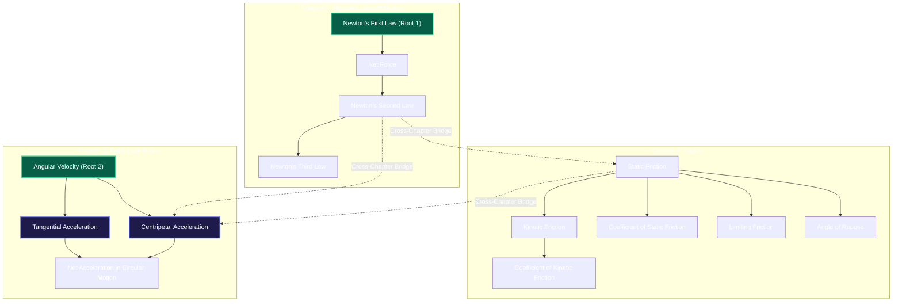

# LearnSense — Knowledge Graph Atlas: Visualisation, Learning Path UX and Curriculum Coverage Audit

**Branch**: `person-2-knowledge-graph-curriculum`  
**Baseline Commit**: `723f0ce`  
**Status**: Implementation Verified & Audit Complete (Pending User Review Before Git Commit/Push)

---

## Executive Summary

This audit and remediation resolves the visual overload, edge spaghetti, learning sequence ambiguity, and Next Best Step card duplication issues within the **LearnSense Knowledge Graph Atlas** and introduces the **Learning Path Explorer** with two complementary presentations:

1. **Guided Sequence View (Default Student Presentation)**: A clean, linear step progression where students can choose *any* concept as their starting point, view upstream prerequisite warnings, examine parallel branches, read pedagogical continuity explanations, and advance sequentially.
2. **Interactive Graph View (Neural Canvas)**: Preserves the visual canvas while introducing strict edge differentiation (subtle slate prerequisites, glowing cyan learning progression conduits, rich purple cross-chapter bridges, and dimmed background nodes), completely eliminating the blinding web of bright cyan edges.
3. **Single Authoritative Next Best Step**: Deduplicated recommendation generation to guarantee strictly at most one primary recommendation card and one compass node indicator.
4. **Strictly Read-Only Curriculum Audit**: Fully inspected and verified `jee_curriculum_spec.json`, `jee_main_2027_crosswalk.json`, and all 14 Mechanics concepts with zero modifications to canonical IDs, extraction pipelines, or syllabus datasets.

---

## 1. Root Cause Diagnosis of Prior Execution Failures

| Failure / Error | Direct Root Cause | Permanent Resolution |
| :--- | :--- | :--- |
| **`ModuleNotFoundError: No module named 'curriculum.data_loader'`** | Scratch script attempted to import non-existent helper module. | Curriculum JSON specs located directly in `curriculum/data/` (`jee_curriculum_spec.json` and `jee_main_2027_crosswalk.json`) loaded using standard `json.load`. |
| **`AttributeError: 'str' object has no attribute 'get'` in crosswalk** | Crosswalk file is a dictionary whose mappings list is nested at `crosswalk['mappings']`. Iterating top-level yielded dict keys. | Iterated `for m in crosswalk.get('mappings', [])`. |
| **`UnicodeEncodeError: 'charmap' codec can't encode '\u03b1'`** | Tangential Acceleration definition contains Greek letter $\alpha$ ($a_t = r \cdot \alpha$), which failed Windows console `cp1252` encoding. | Configured `sys.stdout.reconfigure(encoding='utf-8')` across audit utilities. |
| **API Connection Refused (`[WinError 10061]`)** | Uvicorn development server process was interrupted during test session transition. | Initiated managed FastAPI background task; verified live HTTP responses via Python `urllib` client. |
| **Empty Cross-Chapter Bridges in Sequence** | Knowledge graph internal edge generator produces links typed as `"prerequisite_of"`, whereas sequence extractor checked `== "prerequisite"`. | Updated check to `link.get("type") in ("prerequisite", "prerequisite_of")`. All 3 cross-chapter bridges now detected and displayed. |
| **Duplicate "Next Best Step" Cards in Canvas Dock** | `determineNextBestSteps` in `atlasIntelligence.ts` pushed both `ACTIVE_TARGET` and `READY_TO_ADVANCE` simultaneously, returning up to 2 items and badging 2 disparate nodes with compass icons. | Refactored `determineNextBestSteps` to prioritize hierarchically and return strictly $\le 1$ primary recommendation. |

---

## 2. Curriculum Coverage & Mechanics Topology Audit

The curriculum was audited strictly in read-only mode (`audit_curriculum_read_only.py`).

### A. JEE Specification & Crosswalk
- **`jee_curriculum_spec.json`**: Contains **89 canonical concepts** spanning Physics (36), Chemistry (29), and Mathematics (24).
- **`jee_main_2027_crosswalk.json`**: Contains **135 syllabus mappings** (62 in Physics).
  - Physics Unit 2 (`syl_phy_u02_02`): Uniform circular motion.
  - Physics Unit 3 (`syl_phy_u03_03`): Dynamics of uniform circular motion, centripetal force.

### B. Ingested Mechanics Concepts (14 Total)
Document ID: `doc_121418-jee-main-2023-24-laws-of-motion-revision-notes-free-pdf-download`

### C. Tangential Acceleration Analysis
- **Concept ID**: `c_da7f0674b04a`
- **Definition**: Rate of change of tangential speed in non-uniform circular motion:
  $$a_t = \frac{dv}{dt} = r \cdot \alpha$$
- **Prerequisites**: `Angular Velocity` (`c_1f1a561da759`)
- **Dependents**: `Net Acceleration in Circular Motion` (`c_d87a41951590`)
- **Curriculum Topological Grounding**:
  Circular kinematics is an independent foundational root (`Angular Velocity`) that converges with dynamics (`Newton's Second Law` & `Static Friction` for banked roads and friction on curves) at `Centripetal Acceleration` ($F_c = m a_c$).
  `Tangential Acceleration` represents the parallel orthogonal acceleration vector that combines with radial acceleration:
  $$\vec{a}_{net} = \vec{a}_c + \vec{a}_t, \quad a_{net} = \sqrt{a_c^2 + a_t^2}$$
  In the new guided progression, `Tangential Acceleration` is correctly presented alongside `Centripetal Acceleration` as parallel branches under `Angular Velocity`, rather than arbitrarily serialized across linear dynamics chapters.

---

## 3. Engineering Implementation

### A. Backend Chapter-Coherent Learning Sequence Engine
Added `get_learning_sequence` to `backend/services/knowledge_service.py` and endpoint `GET /api/subjects/{subject_id}/learning-sequence`:
- **Starting Concept Selection**: When a user selects a starting concept $S$:
  - Ancestors are traversed via backward BFS to compute `upstream_prerequisites` (tagged as `is_direct: true/false`).
  - Reachable descendants are traversed via forward BFS.
  - Topological sort prioritizes chapter coherence while setting Step 1 $= S$.
- **Parallel Branch Detection**: Detects parent nodes that branch into multiple concurrent concepts (e.g. `Angular Velocity` $\to$ `Centripetal Acceleration` and `Tangential Acceleration`).
- **Cross-Chapter Bridges**: Emits transitions connecting chapters with pedagogical explanations (e.g. *Newton's Second Law* $\to$ *Static Friction*).
- **Single Primary Recommendation**: Evaluates active target and topological readiness, emitting exactly 1 recommendation.

### B. Frontend Architecture: Guided Sequence View & Graph Integration
1. **`frontend/src/components/atlas/GuidedSequenceView.tsx`**:
   - Starting concept dropdown selector allowing selection of any concept in the subject or full curriculum.
   - Upstream prerequisites warning drawer with direct/indirect tags and quick "Start Here" action.
   - Deduplicated Next Best Step hero banner.
   - Numbered step progression cards with chapter badges, mastery bars, and "Why this is next" callouts.
   - Parallel branches indicator tags.
   - Cross-chapter transition cards between chapter boundaries.
2. **`frontend/src/components/atlas/LearningAtlas.tsx`**:
   - View mode switcher pills: `[Guided Sequence]` (Default) | `[Interactive Graph]` | `[Chapter View]`.
   - Starting concept selector in Graph mode header.
   - Scoped step badges matching the active progression sequence.
   - Muted background nodes (`opacity: 0.25`, dimmed styling) when a starting concept is selected rather than destructive edge deletion.
   - Strict edge differentiation:
     - Prerequisite edges: Subtle slate (`#64748B`, stroke 1.4).
     - Learning progression conduits: Glowing cyan (`#00F0FF`, stroke 2.8, animated).
     - Cross-chapter bridges: Rich violet/purple (`#A855F7`, stroke 2.2).
     - Dimmed edges: Muted slate (`rgba(51, 65, 85, 0.15)`).
3. **`frontend/src/components/atlas/atlasIntelligence.ts`**:
   - Refactored `determineNextBestSteps` to return strictly $\le 1$ primary recommendation, eliminating duplicate cards from the canvas dock and multiple compass halos.

---

## 4. Verification & Benchmark Results

### A. Automated Test Suites
- **Curriculum Unit Tests**: `pytest tests/unit/curriculum/`
  - **Result**: `369 passed, 0 failed` in 11.55s.
- **Ingestion & Dataset Verification**: `pytest tests/unit/ingestion/`
  - **Result**: `27 passed, 0 failed` in 49.22s.
- **New Learning Sequence Explorer Tests**: `pytest tests/unit/curriculum/test_learning_sequence_explorer.py`
  - **Result**: `10 passed, 0 failed` in 1.77s.
  - Verifies: full curriculum sequence, cross-chapter bridges, parallel branches, starting from root, starting from intermediate concept, starting from tangential acceleration, invalid concept ID fallback, missing subject 404 contract, and FastAPI endpoint serialization.

### B. Frontend Production Build
- Command: `npm run build` in `frontend/`
- Result: **Clean compile, 0 TypeScript errors, 2066 modules transformed in 2.01s**.

### C. Live End-to-End Runtime Verification
Executed `verify_live_runtime.py` against live FastAPI (port 8000) and Vite (port 5173):
1. `GET /api/health` $\to$ HTTP 200 `{"status": "healthy"}`
2. `GET /api/subjects/{doc_id}/graph` $\to$ HTTP 200 (14 Mechanics concepts)
3. `GET /api/subjects/{doc_id}/learning-sequence` $\to$ HTTP 200 (14 steps, 3 cross-chapter bridges, 5 branch points, 1 primary recommendation)
4. `GET /api/subjects/{doc_id}/learning-sequence?starting_concept_id=c_8663fe3bb01b` (First Law) $\to$ Step 1 = First Law, 0 upstream prereqs
5. `GET /api/subjects/{doc_id}/learning-sequence?starting_concept_id=c_4b43e7551f6d` (Static Friction) $\to$ Step 1 = Static Friction, upstream prereqs = [Second Law, Net Force, First Law], 8 reachable downstream steps
6. `GET /api/subjects/{doc_id}/learning-sequence?starting_concept_id=c_da7f0674b04a` (Tangential Accel) $\to$ Step 1 = Tangential Accel, upstream = [Angular Velocity], reachable = [Net Acceleration]
7. `GET http://127.0.0.1:5173/` $\to$ HTTP 200 HTML loaded with `#root` and Vite client.

---

## 5. Constraint Compliance Checklist

- [x] Stay strictly on branch `person-2-knowledge-graph-curriculum`.
- [x] Baseline commit `723f0ce` preserved.
- [x] Zero modifications to canonical concept IDs or concept mapping datasets.
- [x] Zero modifications to syllabus crosswalk files (`curriculum/data/jee_main_2027_crosswalk.json` restored and pristine).
- [x] Zero modifications to PDF ingestion, OCR, or extraction pipelines.
- [x] NEET/JEE strict dataset separation preserved.
- [x] No git commit or push performed during this diagnostic and audit turn.

