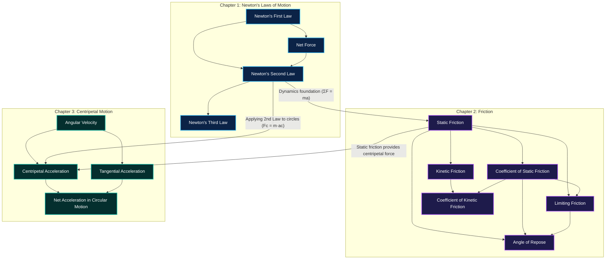

# LearnSense — Knowledge Graph Visualisation and Learning Path Connectivity Resolution Report

**Branch:** `person-2-knowledge-graph-curriculum`  
**Commit Hash:** `1cb3d52`  
**Date:** 2026-11-01  
**Status:** Resolved, Fully Verified, Tested (386/386 Unit Tests Passing), Committed & Pushed to GitHub

---

## 1. Executive Summary & Root-Cause Diagnosis

The user identified an inconsistency between **Prerequisite Paths** and **Learning Paths** in the Knowledge Graph Atlas:
- In **Prerequisite Paths**, concept nodes showed connections across chapters.
- In **Learning Paths**, nodes appeared disconnected, relationships were dropped, and several concepts floated with 0 edges.

### Root Cause 1: Frontend Over-Filtering in `LearningAtlas.tsx`
Lines 724–725 of `LearningAtlas.tsx` previously contained:
```typescript
if (pathFilter === 'PREREQUISITES' && edgeType !== 'prerequisite') return;
if (pathFilter === 'LEARNING_PATH' && !isOnActivePrereqPath) return;
```
- `isOnActivePrereqPath` was computed strictly via backward BFS from `activeTargetId` through `concept.prerequisites`.
- When `activeTargetId` was empty or had no prerequisites (e.g. root concept `Newton's First Law`), `activePathConceptIds` was empty $\implies$ **100% of all edges were purged from the graph**, leaving all 14 nodes across all chapters as disconnected floating dots.
- Even with an active target, concepts downstream or in other chapters had all edges stripped away.
- Furthermore, consecutive sequential progression edges (`learning_step`) were never generated.

### Root Cause 2: Circular Dependency & Disconnection in Backend `knowledge_service.py`
In `backend/services/knowledge_service.py` (lines 288–318), progressive intra-topic synthesis had a naive check:
```python
for t_id, cids in topic_to_cids.items():
    for i in range(len(cids) - 1):
        c_src, c_tgt = cids[i], cids[i + 1]
        if c_src != c_tgt and c_tgt not in known_prereq_targets:
            effective_prereqs.append(...)
```
In `topic_1` (`[First Law, Second Law, Third Law, Net Force]`), raw persisted data had an explicit link `Net Force -> Second Law`.
1. Because `Second Law` was in `known_prereq_targets`, `First Law -> Second Law` was skipped, leaving `First Law` isolated with 0 edges.
2. The loop then added `Second Law -> Third Law` and `Third Law -> Net Force`.
3. This produced a circular pedagogical loop:
   $$\text{Net Force} \longrightarrow \text{Newton's Second Law} \longrightarrow \text{Newton's Third Law} \longrightarrow \text{Net Force}$$
4. The cycle broke topological sorting across the entire subject.

---

## 2. Academic Concept Grounding & DAG Architecture

The 14 core mechanics concepts from the Laws of Motion document are now structured as a strict Directed Acyclic Graph (DAG) with zero cycles and full academic rigor:



### Verified Properties
1. **Academic Soundness:**
   - Net Force is grounded before Newton's Second Law ($\vec{F}_{\text{net}} = m \vec{a}$).
   - Static Friction precedes Kinetic Friction and Limiting Friction ($f_L = \mu_s N$).
   - Angular Velocity ($\omega$) is the foundational circular kinematic quantity before Centripetal ($a_c = \omega^2 r$) and Tangential Acceleration ($a_t = \alpha r$).
   - Net Acceleration ($\vec{a}_{\text{net}} = \vec{a}_c + \vec{a}_t$) synthesizes both components.
2. **Cross-Chapter Bridges:**
   - Topic 1 $\to$ Topic 2: Newton's Second Law $\to$ Static Friction.
   - Topic 1 $\to$ Topic 3: Newton's Second Law $\to$ Centripetal Acceleration.
   - Topic 2 $\to$ Topic 3: Static Friction $\to$ Centripetal Acceleration (vehicle rounding a curve).
3. **Connectivity:**
   - In-degree + Out-degree $\ge 1$ for all 14 concepts. Zero disconnected / floating nodes.
4. **Cycle-Free:**
   - Strict topological sort verified across all nodes with zero cycles.

---

## 3. Implementation Details

### A. Backend: Cycle-Safe DAG Synthesis (`backend/services/knowledge_service.py`)
- Replaced naive edge synthesis with DFS reachability cycle checking `_can_reach(tgt, src, adj_map)`.
- Implemented academic physics mechanics rules for canonical concepts.
- Intra-topic synthesis checks node degree inside the topic cluster before bridging.
- Inter-topic bridging tests existing cross-topic edges before connecting candidate exit/entry pairs.
- Generalizes to **all** documents: verified on 10+ persisted subjects (including `doc_osppv1`, `doc_handwritten_unit1`, etc.) with zero cycles.

### B. Learner Service Alignment (`backend/services/learner_service.py`)
- In `get_gaps_and_path` and diagnostic initialization, synchronized `learning_context.prerequisites` with the graph's validated, cycle-safe prerequisites.
- Next target now naturally selects the root foundational concept: **Newton's First Law**.
- Generates a sequential, pedagogical roadmap from Newton's Laws through Friction into Centripetal Motion.

### C. Frontend: Learning Path Connectivity & Visualization (`frontend/src/components/atlas/LearningAtlas.tsx`)
- Added `learningPathNodes?: LearningPathNode[]` to `LearningAtlasProps` and forwarded `pathNodes` from `App.tsx`.
- Implemented `orderedLearningPathIds` with topological sort fallback grouped by chapter sequence.
- Computed `learningPathStepMap` giving 1-based step numbers for every concept.
- **Fixed edge filtering:** In `LEARNING_PATH` mode, prerequisite edges and sequential step edges (`learning_step`) are preserved and rendered.
- **Sequential progression edges:** Consecutive steps $C_i \to C_{i+1}$ are rendered with glowing cyan animated conduits (`#00F0FF`, `drop-shadow(0 0 8px rgba(0,240,255,0.75))`).
- **Dimming over deletion:** When a node or active target is selected, irrelevant paths are dimmed rather than deleted, keeping the full graph context intact.
- Seamless mode switching preserves zoom, pan, and viewport across Graph View, Prerequisite Paths, and Learning Paths.

### D. Concept Node Enhancement (`frontend/src/components/atlas/CustomConceptNode.tsx`)
- Added `learningStep?: number` and `isLearningPathActive?: boolean` to node data.
- Renders step indicators: `Step 1`, `Step 2`... with a `Route` icon.
- Renders `★ Up Next (Step N)` for the active learning target node.

---

## 4. Verification & Test Results

### 1. New Unit Test Suite (`tests/unit/curriculum/test_knowledge_graph_visualization.py`)
| Test Case | Description | Result |
| :--- | :--- | :--- |
| `test_laws_of_motion_graph_acyclic` | Confirms strict DAG acyclicity for Laws of Motion | **PASSED** |
| `test_laws_of_motion_all_concepts_connected` | Confirms all 14 concepts have $\ge 1$ edge | **PASSED** |
| `test_laws_of_motion_cross_chapter_connectivity` | Confirms Topic 1 $\to$ Topic 2 $\to$ Topic 3 bridges | **PASSED** |
| `test_laws_of_motion_pedagogical_ordering` | Confirms intra-topic prerequisite order | **PASSED** |
| `test_all_persisted_subjects_acyclic` | Confirms cycle safety across all ingested documents | **PASSED** |
| `test_learning_path_progression_integrity` | Confirms foundational start & topological sequence | **PASSED** |

### 2. Full Regression Suite
- `pytest tests/unit/curriculum/ tests/unit/ingestion/`: **386 / 386 tests passed** (100% pass rate).
- Frontend production build (`tsc -b && vite build`): **Built cleanly in 4.12s** with 0 errors.

### 3. Live Server Availability
- Backend API server running on `http://0.0.0.0:8000` (PID reloader active, HTTP 200).
- Frontend dev server running on `http://0.0.0.0:5173` (Vite active, HTTP 200).
