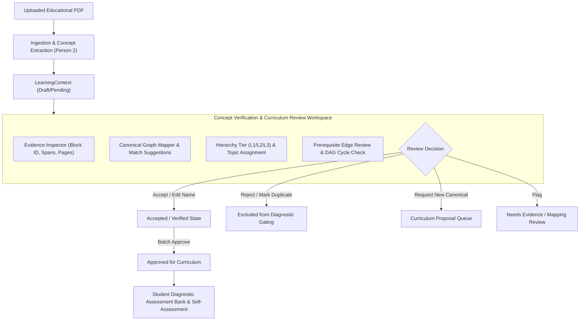

# LearnSense — Manual Concept Verification & Curriculum Review Workflow

## 1. Overview & Purpose

Following the implementation of the generalized document ingestion and semantic concept extraction pipeline (Person 2), the **Manual Concept Verification and Curriculum Review Workflow** provides an auditable, human-in-the-loop governance mechanism.

A teacher or subject-matter expert can inspect, verify, correct, or reject extracted concepts from any uploaded educational PDF before those concepts enter the approved canonical curriculum or become available to downstream diagnostic assessment generation.

---

## 2. Architecture & Components

### Key Service Classes & Modules

1. **`ConceptReviewWorkflowService` (`backend/services/concept_review_service.py`)**:
   - `get_document_review_items(document_id)`: Loads all extracted concepts, verbatim text excerpts, page numbers, block IDs, spans, current canonical mappings, alternative graph candidate suggestions, duplicate candidates, and prerequisite links.
   - `apply_concept_decision(document_id, concept_id, decision, reviewer_id, ...)`: Applies reviewer actions (`accept`, `reject`, `edit_name`, `mark_duplicate`, `request_new_canonical`, `flag_review`, `approve_for_curriculum`). Preserves stable concept IDs and evidence links; appends immutable entries to the document's `review_audit_log`.
   - `apply_prerequisite_decision(document_id, source_id, target_id, action, reviewer_id, reason)`: Validates DAG acyclicity using graph DFS before committing any edge. Rejects circular dependencies with `ReviewConflictError` (`409 Conflict`).
   - `approve_all_verified(document_id, reviewer_id, reason)`: Batch promotes accepted and pending concepts to `approved_for_curriculum` and enables `_enforce_strict_approval = True`.
   - `get_page_evidence(document_id, page_number)`: Retrieves raw layout blocks and text for visual source page validation.
   - `get_audit_history(document_id)`: Provides the complete chronological audit log.

2. **Curriculum REST API Endpoints (`backend/routes/curriculum.py`)**:
   - `GET /api/curriculum/documents/{document_id}/review-items`
   - `POST /api/curriculum/documents/{document_id}/review/decision`
   - `POST /api/curriculum/documents/{document_id}/review/prerequisite`
   - `POST /api/curriculum/documents/{document_id}/review/approve-batch`
   - `GET /api/curriculum/documents/{document_id}/review/audit-history`
   - `GET /api/curriculum/documents/{document_id}/pages/{page_number}/evidence`

3. **Diagnostic Gating Integration (`backend/services/learning_service.py` & `backend/services/knowledge_service.py`)**:
   - `LearningService.submit_self_assessment`: Prunes concepts marked `rejected` or `duplicate`. When `_enforce_strict_approval` is active, restricts authoritative concepts to `approved_for_curriculum` and `accepted`.
   - `LearningService.get_or_create_question_bank`: Restricts question generation targets to approved concepts.
   - `KnowledgeService.get_subject_graph`: Filters out rejected and duplicate concepts from the Knowledge Atlas visualization.

4. **Frontend UI (`frontend/src/components/teacher/ConceptReviewWorkspace.tsx`)**:
   - Integrated as a primary tab (`Concept Verification & Review`) in `TeacherDashboard.tsx`.
   - Also directly accessible via a "Review Concepts" button on each document card in `SourceLibrary.tsx`.

---

## 3. Review Decisions & Actions

| Decision Action | Status Set | Behavior & Effects |
| :--- | :--- | :--- |
| **Accept** | `accepted` | Marks concept as human-verified. Retains ID, evidence, and current mappings. |
| **Reject** | `rejected` | Mandatory reason required. Strictly excludes concept from student self-assessment and question bank. |
| **Edit Name** | Preserves status | Updates student-facing canonical name while preserving the stable `concept_id`, block IDs, and character offsets. |
| **Mark Duplicate** | `duplicate` | Requires `duplicate_of_concept_id`. Excludes duplicate entry from diagnostic generation to avoid duplicate testing. |
| **Request New Canonical** | `accepted` | Sets concept to accepted and dispatches a `ProposedConcept` to the canonical curriculum graph queue. |
| **Flag for Review** | `needs_evidence_review` / `needs_canonical_mapping` | Flags concept for secondary review when text is ambiguous or mapping is uncertain. |
| **Approve for Curriculum** | `approved_for_curriculum` | Promotes concept for immediate inclusion in student onboarding self-assessment and diagnostic quiz generation. |

---

## 4. Prerequisite DAG Validation & Cycle Prevention

Prerequisite modifications are strictly validated using directed cycle detection:
- When a reviewer attempts to approve or add an edge (e.g. `A -> B -> C -> A`), the service traverses the candidate graph.
- If a directed cycle is detected, the operation aborts with `ReviewConflictError` and returns `HTTP 409 Conflict` to the UI:
  > *"Adding prerequisite edge 'C' -> 'A' would create a prerequisite cycle."*
- Unsound pedagogical loops are thus physically prevented from entering the curriculum.

---

## 5. Verification Suite & Test Results

A dedicated test suite in `tests/unit/curriculum/test_concept_review_workflow.py` verifies all aspects of the workflow:

| Test Case | Scope | Result |
| :--- | :--- | :---: |
| `test_get_document_review_items` | Review payload structure, status counts, evidence | **PASSED** |
| `test_accept_concept` | Reviewer decision persistence & audit log | **PASSED** |
| `test_edit_concept_name_preserves_stable_id` | Rename preservation of stable ID and evidence offsets | **PASSED** |
| `test_reject_concept_requires_reason` | Mandatory rejection rationale validation | **PASSED** |
| `test_mark_duplicate_concept` | Intra-document duplicate linking | **PASSED** |
| `test_request_new_canonical_concept` | Curriculum queue proposal dispatch | **PASSED** |
| `test_flag_for_review` | Evidence & canonical mapping review flags | **PASSED** |
| `test_unauthorized_action_missing_reviewer` | Rejection of unauthenticated/empty reviewer IDs | **PASSED** |
| `test_hierarchy_level_and_topic_reassignment` | L1/L2/L3 and parent topic adjustment | **PASSED** |
| `test_prerequisite_approval_and_rejection` | Edge approval and rejection | **PASSED** |
| `test_prerequisite_cycle_prevention` | Directed cycle detection & Conflict error | **PASSED** |
| `test_batch_approval_and_strict_gating` | Batch promotion & diagnostic exclusion verification | **PASSED** |
| `test_audit_history_recording` | Chronological audit trail integrity | **PASSED** |
| `test_rest_api_concept_review_endpoints` | FastAPI TestClient end-to-end endpoint verification | **PASSED** |

### Complete Regression Suite Status
- **Curriculum & Ingestion Test Suite:** **380 / 380 PASSED** in 1m 55s.
- **Frontend Production Build (`tsc -b && vite build`):** **0 errors**, built in 1.99s.

---

## 6. Live Testing & Execution Details

Per the user's explicit instructions, the full application is kept running live as background daemon processes:

- **Backend API Server:** `http://localhost:8000` (FastAPI / Uvicorn)
- **Frontend Web Application:** `http://localhost:5173` (React 19 / Vite / Tailwind)

### Quick Manual Test Guide for the User:
1. Open your browser and navigate to `http://localhost:5173`.
2. Select or switch to a **Teacher** persona (e.g. "Dr. Aris Vance" or "Prof. Elena Rostova") via the user switcher in the navbar.
3. In the Teacher Hub, click on the **Concept Verification & Review** tab (badge: `Person 2`).
4. Select `doc_121418-jee-main-2023-24-laws-of-motion-revision-notes-free-pdf-download` or any other uploaded document from the dropdown.
5. Review the extracted concepts:
   - Click any concept on the left to inspect its **Verbatim Evidence**, **Page Number**, **Block ID**, and **Offsets**.
   - Click **Inspect Page** to view the full source page layout blocks.
   - Test **Accept**, **Edit Name**, **Reject** (with reason), or **Mark Duplicate**.
   - Check the **Prerequisites** tab to test edge approval or cycle rejection.
   - Click **Approve All Verified** to promote concepts to the canonical curriculum.

