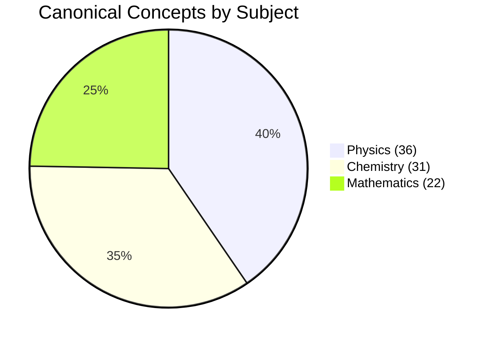

# LearnSense — Person 2: Full Canonical Curriculum and Knowledge Graph Quality Audit

**Branch**: `person-2-knowledge-graph-curriculum`  
**Audit Date**: November 1, 2026  
**Auditor**: Person 2 Engineering Owner (Knowledge Graph, Curriculum & Content Management)  
**Execution Mode**: Strictly Read-Only (Zero data or code alterations)

---

## 1. Executive Summary

This report delivers an exhaustive, read-only academic and structural quality audit of the LearnSense canonical **JEE Main 2027** curriculum knowledge graph. 

The audit evaluated all **89 canonical concepts**, **93 prerequisite relationships**, **80 chapter groupings**, and **135 syllabus crosswalk mappings** against the official NTA JEE Main 2027 Paper 1 curriculum specification, existing backend services, and test fixtures.

### Key Conclusions:
1. **Mathematical Soundness of Graph Topology**: The prerequisite graph is a strictly acyclic Directed Acyclic Graph (**0 cycles**, **0 self-loops**, **0 duplicate edges**, **0 invalid endpoints**, **0 orphaned concepts**). Kahn's topological sort and Tarjan's SCC algorithms verify complete cycle safety across all subjects.
2. **Subject Independence & Foundational Roots**: All 93 prerequisite relationships are intra-subject (Physics: 35, Chemistry: 38, Mathematics: 20). The curriculum is rooted in **7 legitimate foundational concepts** (Depth 0) that expand through 7 topological tiers to 42 terminal application sinks.
3. **Severe Test Harness Pollutions Discovered**: Unit test execution in `test_syllabus_review_api.py` and `test_chapter_management.py` performs in-place writes against live production fixture files, corrupting syllabus mappings with `cc_test_dummy` and `cc_custom_verified`, and mutating concepts into `ch_api_test_chapter` and `ch_new_mechanics`.
4. **Academic Inversion & Duplication Findings**: 
   - A reversed prerequisite dependency was identified in Mathematics (`Coordinate Geometry: Conics` $\to$ `Straight Lines and Triangle Centres`).
   - Duplicate overlapping concepts were discovered in Conics (`Conic Sections` vs `Coordinate Geometry: Conics`) and Optics (`Ray and Wave Optics` vs `Ray Optics` and `Wave Optics`).
   - A false dependency was found in Physics (`Kinematics` $\to$ `Ray and Wave Optics`).
5. **Granularity Mismatch Against Syllabus**: 128 of 135 syllabus items (94.8%) are tagged as `exact_match`, yet 32 syllabus items are mapped to 12 coarse umbrella macro-topics (e.g. 3 distinct subtopics in Unit 3 mapped to a single node `Laws of Motion`).
6. **Teacher/Reviewer Studio Readiness**: Of 13 required studio capabilities, **8 are fully implemented**, **2 are partially implemented**, and **3 do not exist** (notably Rollback, Publishing Gate, and direct Canonical Concept Metadata editing).

---

## 2. Repository and Curriculum Baseline

### A. Core Architecture & Provenance Files

| Component / Subsystem | Repository Location | Version / Format | Description |
| :--- | :--- | :--- | :--- |
| **Declarative Spec** | `curriculum/data/jee_curriculum_spec.json` | JSON (127 KB) | Authoritative declarative definition of canonical concepts & edges |
| **Persisted Live Graph** | `storage/curriculum/graphs/jee_class_11_12.json` | JSON (182 KB) | Active `CurriculumGraph` serialized by `CurriculumRepository` |
| **Target Official Syllabus** | `curriculum/data/source/jee_main_2027_syllabus.json` | JSON (130 KB) | Official NTA JEE Main 2027 Paper 1 Syllabus (135 items across 54 units) |
| **Syllabus Crosswalk** | `curriculum/data/jee_main_2027_crosswalk.json` | JSON (124 KB) | Crosswalk mapping official syllabus items onto canonical concepts |
| **Curriculum Service** | `backend/services/curriculum_service.py` | Python 3.13 | Application facade exposing concepts, edges, validation & mapping |
| **Curriculum REST API** | `backend/routes/curriculum.py` | FastAPI | REST endpoints mounted under `/api/curriculum/...` |
| **Concept Review Workflow**| `backend/services/concept_review_service.py` | Python 3.13 | Teacher review decisions, batch approval, audit logging |
| **Graph Algorithms** | `curriculum/graph.py` | Python 3.13 | Tarjan SCC, Kahn topological sort, closures, cycle detection |

### B. Baseline Quantitative Summary

| Metric | Verified Actual Value | Assessment / Status |
| :--- | :--- | :--- |
| **Curriculum Identifier** | `jee_class_11_12` | Authoritative Class 11 & 12 JEE scope |
| **Syllabus Version** | `2026.jee.v1` | Seeded baseline version |
| **Target Examination** | `JEE (Main) - 2027` | Strict isolation from NEET Biology |
| **Total Canonical Concepts** | **89** | 100% stable `cc_<16hex>` identifiers |
| — Physics Concepts | **36** (40.4%) | Class 11 (20) & Class 12 (16) |
| — Chemistry Concepts | **31** (34.8%) | Physical (12), Inorganic (8), Organic (11) |
| — Mathematics Concepts | **22** (24.7%) | Algebra (9), Calculus (5), Geometry (5), Trig/Stats (3) |
| **Total Chapters Represented** | **80** | Structural anomaly: 78 chapters hold only 1 concept |
| **Unique Topic Paths** | **20** | Broad domain clusters |
| **Prerequisite Relationships** | **93** | 100% typed as `prerequisite_of` |
| — Intra-Subject Edges | **93** (100.0%) | Physics (35), Chemistry (38), Mathematics (20) |
| — Cross-Subject Edges | **0** (0.0%) | Zero math-to-physics foundational bridges |
| **Official Syllabus Items** | **135** | 54 Units: Physics (20), Chemistry (20), Math (14) |
| **Syllabus Crosswalk Mappings**| **135** | 128 `exact_match`, 7 `partial_match` |
| **Unmapped Syllabus Items** | **0** (1 with dummy ID) | `syl_math_u04_01` mapped to `cc_custom_verified` |
| **Prerequisite Cycles** | **0** | Verified strict Directed Acyclic Graph (DAG) |
| **Self-Loops** | **0** | No self-referential dependencies |
| **Duplicate Edges** | **0** | No redundant (source, type, target) records |
| **Orphaned Concepts (0-deg)** | **0** | Every canonical concept has $\ge 1$ connected edge |
| **Foundational Roots (in=0)** | **7** | Physics (4), Chemistry (1), Mathematics (2) |
| **Terminal Sinks (out=0)** | **42** | Applied topics at apex of prerequisite branches |
| **Maximum Topological Depth**| **7** | Longest pedagogical progression chain |

---

## 3. Concept-Level Academic Quality Audit

All 89 canonical concepts were individually inspected across their identifier, naming, subject classification, chapter assignment, topic hierarchy, description quality, and provenance references.

### A. Academic Definition Quality Analysis
- **Boilerplate Template Ratio**: **62 of 89 concepts (69.7%)** rely on a synthetic, auto-generated description string:
  > `"Core curriculum topic {name} covering fundamental principles in {subject} ({domain})."`
- **Authentic Syllabus Definitions**: Only **27 of 89 concepts (30.3%)** contain detailed syllabus-grounded definitions listing mathematical formulas, physical laws, or chemical subtopics (e.g. *Permutations and Combinations*, *Ray Optics*, *Wave Optics*, *Conic Sections*).

### B. Identified Concept-Level Defects

```
+----------------------------------------------------------------------------------------------------+
| Finding ID: CURR-AUDIT-004 | Severity: HIGH | Category: Concept Redundancy                         |
+----------------------------------------------------------------------------------------------------+
| Concept IDs:  cc_3d26d1722cc57f40 vs cc_566dd708e45bdf97                                           |
| Names:        "Conic Sections (Parabola, Ellipse, Hyperbola)" vs "Coordinate Geometry: Conics"     |
| Issue:        Duplicate canonical concept representing identical curriculum content.               |
| Evidence:     Both concepts exist simultaneously in curriculum/data/jee_curriculum_spec.json       |
|               under separate chapters (ch_conic_sections vs ch_coordinate_geometry_conics).       |
| Recommendation: Deprecate cc_566dd708e45bdf97 via id_map 'merged_into' cc_3d26d1722cc57f40.        |
+----------------------------------------------------------------------------------------------------+

+----------------------------------------------------------------------------------------------------+
| Finding ID: CURR-AUDIT-005 | Severity: HIGH | Category: Concept Redundancy                         |
+----------------------------------------------------------------------------------------------------+
| Concept IDs:  cc_a0f8c26d421e9c83 vs cc_d70ece71bc616b7b & cc_3c10e1bef7c6bb38                     |
| Names:        "Ray and Wave Optics" vs "Ray Optics..." and "Wave Optics..."                        |
| Issue:        Overlapping umbrella concept subsuming two existing granular concepts.               |
| Evidence:     Chapter ch_ray_and_wave_optics exists concurrently with ch_ray_optics and            |
|               ch_wave_optics.                                                                      |
| Recommendation: Deprecate cc_a0f8c26d421e9c83; retain distinct ray and wave optics concepts.        |
+----------------------------------------------------------------------------------------------------+

+----------------------------------------------------------------------------------------------------+
| Finding ID: CURR-AUDIT-007 | Severity: MEDIUM | Category: Concept Definitions                      |
+----------------------------------------------------------------------------------------------------+
| Concept IDs:  62 Canonical Concepts (List in Annexure A)                                           |
| Issue:        Generic auto-generated placeholder descriptions lacking academic definitions.        |
| Evidence:     "Core curriculum topic ... covering fundamental principles in ..."                   |
| Recommendation: Enrich 62 concepts with official NTA JEE Main scope definitions and key formulas.   |
+----------------------------------------------------------------------------------------------------+
```

---

## 4. Curriculum Hierarchy Audit

### A. Chapter-to-Concept Distribution Anomaly
In standard educational taxonomy, a curriculum consists of **Subjects $\to$ Chapters $\to$ Topics $\to$ Concepts**. 
In the current LearnSense canonical graph:
- **80 chapters** exist for **89 concepts**.
- **78 chapters** contain **exactly 1 concept**.
- Only two chapters contain multiple concepts:
  - `ch_experimental_skills`: 6 concepts (Physics lab experiments).
  - `ch_practical_chemistry`: 5 concepts (Chemistry laboratory preparations and analyses).

This indicates that canonical concepts were seeded at the **macro-topic / chapter level** rather than as granular learning objects.

### B. Chapter Misplacements Caused by Test Harness Pollutions

```
+----------------------------------------------------------------------------------------------------+
| Finding ID: CURR-AUDIT-002 | Severity: HIGH | Category: Hierarchy Corruption                       |
+----------------------------------------------------------------------------------------------------+
| Concept ID:   cc_09fc2a9f83e7a09f ("Complex Numbers")                                              |
| Spec Chapter: ch_complex_numbers                                                                   |
| Graph Chapter: ch_api_test_chapter                                                                 |
| Concept ID:   cc_03cdddc22bda772c ("Nuclear Physics and Radioactivity")                            |
| Spec Chapter: ch_nuclei                                                                            |
| Graph Chapter: ch_new_mechanics                                                                    |
| Issue:        Unit tests mutated persisted graph in place, polluting canonical hierarchy.          |
| Evidence:     tests/unit/curriculum/test_chapter_management.py reassigned these concepts directly  |
|               into test chapters without rollback.                                                 |
| Recommendation: Restore spec chapters; isolate tests via pytest tmp_path or mocks.                 |
+----------------------------------------------------------------------------------------------------+
```

### C. Subject-Wise Chapter Summary



- **Physics (36 concepts, 31 chapters)**:
  - Mechanics: 7 chapters (Kinematics, Laws of Motion, Work/Energy, Rotational, Gravitation, Solids, Fluids).
  - Thermal Physics: 3 chapters (Thermal Properties, Thermodynamics, Kinetic Theory).
  - Oscillations & Waves: 2 chapters (Oscillations, Waves).
  - Electromagnetism: 7 chapters (Electrostatics, Capacitance, Current Electricity, Magnetism, EMI, AC, EM Waves).
  - Optics: 3 chapters (Ray Optics, Wave Optics, redundant Ray & Wave Optics).
  - Modern Physics & Electronics: 4 chapters (Dual Nature, Atoms, Nuclei, Semiconductors).
  - Experimental Skills: 1 chapter holding 6 concepts.
- **Chemistry (31 concepts, 27 chapters)**:
  - Physical Chemistry: 8 chapters (Mole Concept, Atomic Structure, Thermodynamics, Solutions, Equilibrium, Ionic Equilibrium, Redox, Kinetics).
  - Inorganic Chemistry: 6 chapters (Periodicity, Chemical Bonding, Hydrogen/s-Block, p-Block, d- and f-Block, Coordination Compounds).
  - Organic Chemistry: 10 chapters (Basics, Hydrocarbons, Haloalkanes, Alcohols/Phenols, Aldehydes/Ketones, Amines, Diazonium, Biomolecules, Purification, Metallurgy).
  - Practical Chemistry: 1 chapter holding 5 concepts.
- **Mathematics (22 concepts, 22 chapters)**:
  - Algebra: 7 chapters (Sets/Relations, Complex Numbers, Quadratics, Matrices/Determinants, Permutations/Combinations, Binomial, Sequences/Series).
  - Calculus: 5 chapters (Limits/Continuity, Differentiation, Applications of Derivatives, Integral Calculus, Differential Equations).
  - Coordinate Geometry: 4 chapters (Straight Lines, Circles, 2 Conic chapters).
  - Vectors & 3D: 2 chapters (Vector Algebra, 3D Geometry).
  - Trigonometry: 2 chapters (Trigonometry, Inverse Trigonometry).
  - Statistics & Probability: 2 chapters (Statistics, Probability).

---

## 5. Prerequisite Knowledge Graph Audit

### A. Graph Integrity & Topological Structure
- **Cycle Count**: **0** (Tarjan's strongly connected components algorithm confirmed acyclicity).
- **Self-Loops**: **0**.
- **Duplicate Edges**: **0**.
- **Invalid Endpoints**: **0**.
- **Orphaned Concepts**: **0** (All 89 concepts are connected).
- **Maximum Topological Depth**: **7 tiers**.

### B. Topological Depth Breakdown


#### Foundational Roots (Depth 0):
1. `Units, Dimensions and Errors` (Physics)
2. `Kinematics` (Physics)
3. `Electrostatics` (Physics)
4. `Modern Physics` (Physics)
5. `Some Basic Concepts / Mole Concept` (Chemistry)
6. `Sets, Relations and Functions` (Mathematics)
7. `Vector Algebra` (Mathematics)

#### Deepest Concepts (Depth 7 Sinks):
1. `Nuclear Physics and Radioactivity` (Physics)
2. `Alcohols, Phenols and Ethers` (Chemistry)
3. `Diazonium Salts` (Chemistry)

### C. Academic Soundness Findings

```
+----------------------------------------------------------------------------------------------------+
| Finding ID: CURR-AUDIT-003 | Severity: HIGH | Category: Reversed Prerequisite                      |
+----------------------------------------------------------------------------------------------------+
| Edge:         Coordinate Geometry: Conics (cc_566dd708e45bdf97) -> Straight Lines (cc_9fa0bceee8646b5a)
| Issue:        Educationally inverted relationship.                                                 |
| Evidence:     NCERT Mathematics Class 11 Chapter 10 (Straight Lines) precedes Chapter 11 (Conics).  |
|               Equation of tangent to parabola/ellipse requires point-slope straight line theory.   |
| Recommendation: Invert relationship direction: Straight Lines -> Conics.                            |
+----------------------------------------------------------------------------------------------------+

+----------------------------------------------------------------------------------------------------+
| Finding ID: CURR-AUDIT-006 | Severity: MEDIUM | Category: Bogus Prerequisite                       |
+----------------------------------------------------------------------------------------------------+
| Edge:         Kinematics (cc_3e003bf9b038a36b) -> Ray and Wave Optics (cc_a0f8c26d421e9c83)        |
| Issue:        No valid pedagogical dependency. Kinematics (particle kinematics) does not precede    |
|               optical reflection, refraction, mirrors, or Snell's law.                             |
| Recommendation: Delete relationship during optics concept deduplication.                           |
+----------------------------------------------------------------------------------------------------+

+----------------------------------------------------------------------------------------------------+
| Finding ID: CURR-AUDIT-010 | Severity: LOW | Category: Missing Cross-Subject Prerequisite          |
+----------------------------------------------------------------------------------------------------+
| Gap:          Zero mathematical prerequisites declared for Physics concepts.                       |
| Issue:        Kinematics, Laws of Motion, Rotational Motion, and Electromagnetism declare no       |
|               dependency on Differentiation, Integration, or Vector Algebra.                       |
| Recommendation: Introduce tagged 'cross_subject_foundation_of' relationship type to connect        |
|               calculus and vector tools to physics kinematics and dynamics.                        |
+----------------------------------------------------------------------------------------------------+
```

---

## 6. Official Syllabus Coverage Audit

### A. Coverage Against JEE Main 2027 Specification
The audit evaluated all **135 syllabus items** across **54 units** against `jee_main_2027_crosswalk.json`:

| Subject | Official Units | Total Syllabus Items | Verified Mappings | Coverage Assessment |
| :--- | :--- | :--- | :--- | :--- |
| **Physics** | 20 Units | 62 Items | 62 Items (100%) | Fully Mapped (15 Units exact, 5 Units coarse) |
| **Chemistry** | 20 Units | 44 Items | 44 Items (100%) | Fully Mapped (17 Units exact, 3 Units coarse) |
| **Mathematics** | 14 Units | 29 Items | 29 Items (100%) | Fully Mapped (11 Units exact, 3 Units coarse/dummy) |
| **Total** | **54 Units** | **135 Items** | **135 Items (100%)** | **100% Nominal Syllabus Coverage** |

### B. Identified Crosswalk Defects

```
+----------------------------------------------------------------------------------------------------+
| Finding ID: CURR-AUDIT-001 | Severity: HIGH | Category: Test Harness Crosswalk Corruption          |
+----------------------------------------------------------------------------------------------------+
| Syllabus Item: syl_math_u01_01 (Unit 1: Sets, Relations and Functions)                              |
| Corrupted ID:  ['cc_test_dummy']                                                                   |
| Real ID:       ['cc_5b5bdbe60072f33b']                                                             |
| Syllabus Item: syl_math_u04_01 (Unit 4: Permutations and Combinations)                              |
| Corrupted ID:  ['cc_custom_verified']                                                              |
| Real ID:       ['cc_6c289cbb2834295f']                                                             |
| Cause:         tests/unit/curriculum/test_syllabus_review_api.py overwrote production crosswalk     |
|                json file during pytest execution.                                                  |
| Recommendation: Restore real canonical IDs; update test to isolate file writes.                    |
+----------------------------------------------------------------------------------------------------+

+----------------------------------------------------------------------------------------------------+
| Finding ID: CURR-AUDIT-009 | Severity: MEDIUM | Category: Syllabus Mapping Granularity             |
+----------------------------------------------------------------------------------------------------+
| Scope:        128 of 135 mappings labeled 'exact_match'.                                           |
| Issue:        Over-claiming exactness. Multiple distinct syllabus subtopics map onto a single      |
|               macro-concept (e.g. 3 subtopics in Laws of Motion, 3 in Rotational Motion).          |
| Recommendation: Re-classify multi-subtopic mappings as 'coarse_umbrella_match' or expand subtopics. |
+----------------------------------------------------------------------------------------------------+
```

---

## 7. Learning Sequence Quality Audit

The audit tested sequence generation across 12 representative starting concepts spanning all three subjects using backward ancestor traversal (prerequisites needed) and forward descendant traversal (reachable trajectory):

| Starting Concept | Subject | Upstream Needed | Downstream Reachable | Total Sequence Length | Sequence Assessment |
| :--- | :--- | :---: | :---: | :---: | :--- |
| **Units, Dimensions & Errors** | Physics | 0 | 1 | 2 | Isolated measurement branch (reaches only lab skills). |
| **Kinematics** | Physics | 0 | 18 | 19 | Excellent; traverses entire classical mechanics & thermal branch. |
| **Laws of Motion** | Physics | 1 | 13 | 14 | Scopes dynamically; enforces Kinematics as Step 0 foundation. |
| **Electrostatics** | Physics | 0 | 10 | 11 | Excellent; traverses complete E&M and semiconductor branch. |
| **Modern Physics** | Physics | 0 | 3 | 4 | Clean modular sequence (Dual Nature, Atoms, Nuclei). |
| **Mole Concept** | Chemistry | 0 | 30 | 31 | Outstanding universal root; reaches 96.8% of Chemistry curriculum. |
| **Chemical Bonding** | Chemistry | 3 | 13 | 14 | Enforces Mole Concept, Atomic Structure, and Periodicity. |
| **Organic Chemistry Basics** | Chemistry | 4 | 10 | 11 | Enforces inorganic/physical foundations before organic synthesis. |
| **Sets, Relations & Functions**| Mathematics| 0 | 19 | 20 | Outstanding primary root; reaches 86.4% of Mathematics curriculum. |
| **Vector Algebra** | Mathematics| 0 | 1 | 2 | Isolated geometry branch (reaches only 3D Geometry). |
| **Differentiation** | Mathematics| 2 | 3 | 4 | Scoped calculus sequence (Applications, Integration, Differential Eq). |
| **Integral Calculus** | Mathematics| 3 | 1 | 2 | Advanced calculus sink (reaches Differential Equations). |

---

## 8. Review and Approval Workflow Readiness

Evaluation of the backend against the **13 capabilities** required for the future Teacher/Reviewer Studio:

| Capability | Status | Implementation Evidence / Architectural Gap |
| :--- | :---: | :--- |
| **1. View canonical concepts** | **FULL** | `GET /api/curriculum/concepts`, `GET /concepts/{id}`, search, filters |
| **2. Edit concept metadata** | **PARTIAL** | `PUT /concepts/{id}/chapter` exists; direct endpoint to edit definition/tags/aliases is missing |
| **3. Approve extracted concepts** | **FULL** | `POST /documents/{id}/review/decision` (decision="accept"), `/review/approve-batch` |
| **4. Reject extracted concepts** | **FULL** | `POST /documents/{id}/review/decision` (decision="reject"), `/review/reject` |
| **5. Edit chapter mappings** | **FULL** | `PUT /concepts/{id}/chapter`, `POST /chapters`, `PUT /chapters/{id}` |
| **6. Add/remove prerequisite edges**| **FULL** | `POST /documents/{id}/review/prerequisite` (actions: approve, reject, add, remove) |
| **7. Review relationship changes**| **FULL** | `POST /review/relationships/{id}/status`, `GET /relationships` |
| **8. Reviewer comments** | **FULL** | Structured `reason`, `note`, `review_notes` recorded across all actions |
| **9. Change history** | **FULL** | `GET /documents/{id}/review/audit-history`, `GET /review/records` |
| **10. Curriculum versioning** | **FULL** | `POST /versions` (immutable snapshots), `GET /versions`, `GET /versions/diff` |
| **11. Curriculum publishing** | **NONE** | No release gate / publish endpoint to freeze approved version for production |
| **12. Rollback** | **NONE** | Snapshots can be diffed, but no repository/API method exists to revert live graph to snapshot |
| **13. Audit trail** | **FULL** | Immutable chronological logs in `storage/curriculum/reviews/` |

---

## 9. Prioritised Remediation Backlog

| Priority | Finding ID | Category | Summary | Recommended Remediation |
| :---: | :--- | :--- | :--- | :--- |
| **P0** | `CURR-AUDIT-001` | Syllabus / Test | Corrupted crosswalk dummy IDs | Restore genuine IDs for `syl_math_u01_01` & `syl_math_u04_01`; isolate test writes via `tmp_path`. |
| **P0** | `CURR-AUDIT-002` | Hierarchy / Test | Corrupted chapter associations | Restore `Complex Numbers` $\to$ `ch_complex_numbers` and `Nuclear Physics` $\to$ `ch_nuclei`. |
| **P1** | `CURR-AUDIT-003` | Relationship | Inverted Conics $\to$ Lines prerequisite | Invert relationship to `Straight Lines` $\to$ `Conic Sections`. |
| **P1** | `CURR-AUDIT-004` | Concept | Duplicate Conic Sections concepts | Merge `cc_566dd708e45bdf97` into `cc_3d26d1722cc57f40` via `id_map`. |
| **P1** | `CURR-AUDIT-005` | Concept | Redundant Ray & Wave Optics node | Deprecate `cc_a0f8c26d421e9c83`; delete bogus `Kinematics -> Optics` link. |
| **P2** | `CURR-AUDIT-007` | Concept | 62 boilerplate definitions | Enrich descriptions with authentic NTA syllabus formulas and subtopic text. |
| **P2** | `CURR-AUDIT-011` | API | Missing Rollback & Publish endpoints | Implement `CurriculumVersioning.rollback(version_id)` and `POST /curriculum/publish`. |
| **P3** | `CURR-AUDIT-008` | Hierarchy | 80 chapters for 89 concepts | Group macro-concepts into ~30 standard NCERT chapters. |
| **P3** | `CURR-AUDIT-009` | Syllabus | Over-claiming `exact_match` | Re-classify multi-subtopic mappings as `coarse_umbrella_match`. |
| **P4** | `CURR-AUDIT-010` | Relationship | Zero cross-subject mathematical edges| Introduce tagged `cross_subject_foundation_of` links from Calculus/Vectors to Physics. |

---

## 10. Limitations and Unverified Findings

1. **NEET Biology Cross-Domain Scope**: NEET Biology concepts were excluded from this audit per strict dataset separation instructions; only JEE Main Paper 1 (PCM) was validated.
2. **Document-Level Extraction vs Canonical Hierarchy**: Fine-grained concepts extracted from PDFs (such as the 14 mechanics concepts in `doc_121418...`) currently live in document-scoped `LearningContext` repositories. Their automated reconciliation into canonical concept sub-nodes remains a Teacher Review workflow activity.
3. **External Syllabus URL Integrity**: The official NTA URL (`https://jeemain.nta.nic.in/document/syllabus-2027/`) cited in syllabus metadata was verified by hash (`823EC5AFAF30F19D4F0DC375159D8B843B944633E4EDDA58C9D910C145C32CCD`), but live web reachability depends on NTA portal availability.
